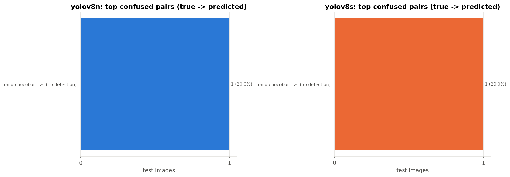

# retail-shelf-detection

ตรวจจับและจำแนกสินค้าในร้านค้าปลีก (110 คลาส) ด้วย **YOLOv8n เทียบกับ YOLOv8s**
ใช้ transfer learning จาก weights ที่ pretrain บน COCO แล้ว fine-tune บน dataset *Sell Products* ของ O2O Minimart

> **สรุปผล:** ทั้งสองโมเดลทำได้เกือบสมบูรณ์บน test set (mAP@0.5 ≈ 0.98, accuracy ระดับรูป 566/567)
> YOLOv8s ได้ mAP@0.5:0.95 สูงกว่า 0.76 จุด แต่ช้ากว่าเกือบ 2 เท่า และทายผิดรูปเดียวกันกับ YOLOv8n
> **YOLOv8n จึงคุ้มกว่าสำหรับการใช้งานจริง** (รายละเอียดในข้อ 7.6)
> ตัวเลขทั้งหมดมาจากการรัน `notebooks/train_eval.ipynb` บน Google Colab ด้วย dataset version 3

---

## Dataset

| | |
|---|---|
| ชื่อ | Sell Products – O2O Minimart (Roboflow Universe) |
| ลิงก์ | <https://universe.roboflow.com/o2o-minimart/sell-products> |
| งาน | Object detection, 110 คลาส (เช่น `pepsi`, `lays-salt`, `mama-pork`, `taro-original`) |
| ขนาด | 8,988 รูปต้นฉบับ; version 3 ที่ใช้มี 13,557 รูป = train 11,867 (รวมรูปที่ augment แล้ว) / valid 1,123 / test 567 |
| Split | ใช้ train / valid / test ตามที่ Roboflow แบ่งไว้ (test ไม่ถูกใช้ระหว่างเทรน) |
| License | **CC BY 4.0** – ใช้ได้โดยต้องอ้างอิงแหล่งที่มา |

```bibtex
@misc{sell-products_dataset,
  title        = {Sell Products Dataset},
  author       = {O2O Minimart},
  howpublished = {\url{https://universe.roboflow.com/o2o-minimart/sell-products}},
  journal      = {Roboflow Universe},
  publisher    = {Roboflow},
  note         = {License: CC BY 4.0}
}
```

ไม่มีการ commit ตัว dataset, weights (`*.pt`) หรือ API key ลง repo (ดู `.gitignore`)

---

## ข้อ 5 — ขั้นตอนการทดลอง

1. **ดึงข้อมูล** – ใช้ Roboflow API export เป็นฟอร์แมต `yolov8` (`src/data.py: download_dataset`)
   API key อ่านจาก Colab/Kaggle secret หรือ `.env` เท่านั้น จากนั้นเขียน `data_abs.yaml` ใหม่ด้วย absolute path
   เพราะ `data.yaml` ของ Roboflow ใช้ path แบบ `../train/images` ซึ่งมักชี้ผิดที่
2. **EDA** (`src/data.py: run_eda`) – นับรูป/กล่องต่อ split, จำนวนกล่องต่อคลาส (ดูความไม่สมดุลของคลาส),
   จำนวนกล่องต่อรูป และขนาดกล่องเทียบกับรูป
3. **Preprocessing** – letterbox resize เป็น 640×640, normalize เป็น 0–1 และใช้ augmentation ของ YOLO ระหว่างเทรน:
   mosaic (ปิดใน 10 epoch สุดท้าย), horizontal flip 0.5, HSV jitter (h 0.015, s 0.7, v 0.4), scale 0.5, translate 0.1
4. **โมเดล** – YOLOv8n (~3M params, เน้นเร็ว) กับ YOLOv8s (~11M params, เน้นแม่น) ทั้งคู่เริ่มจาก COCO weights
   แล้วเปลี่ยน detection head เป็น 110 คลาส (transfer learning)
5. **เทรน** – config เดียวกันทั้งสองตัวเพื่อให้เทียบกันได้แฟร์:
   `epochs=25, imgsz=640, batch=16, patience=5 (early stopping), seed=0, deterministic=True`, optimizer `auto`
   เทรนบน Google Colab T4 (หรือแยก v8n/v8s ไปรัน Colab กับ Kaggle พร้อมกัน), เก็บ `runs/` ไว้ใน Google Drive กันหลุด
6. **ประเมิน** – ใช้ `best.pt` (mAP ดีที่สุดบน valid) ไปรันบน **test set** ซึ่งไม่ได้ใช้ตอนเทรนหรือเลือกโมเดล
   (`src/evaluate.py`)

### ผล EDA

<!-- AUTO:eda:START -->
| split | images | boxes | background_images | single_class_images_pct | boxes_per_image_mean | boxes_per_image_max | classes_present | box_area_median_pct |
|---|---|---|---|---|---|---|---|---|
| train | 11867 | 12008 | 0 | 100.0 | 1.01 | 5 | 110 | 41.5 |
| valid | 1123 | 1139 | 0 | 99.9 | 1.01 | 7 | 110 | 39.0 |
| test | 567 | 574 | 0 | 100.0 | 1.01 | 4 | 110 | 39.3 |
<!-- AUTO:eda:END -->

สิ่งที่เห็นจาก EDA

* **เกือบทุกรูปมีสินค้าชนิดเดียว** (99.9–100% ของรูป) เฉลี่ย 1.01 กล่องต่อรูป และกล่องกินพื้นที่ประมาณ **40% ของภาพ** (median)
  ยืนยันว่าเป็นภาพสินค้าทีละชิ้นถ่ายใกล้ ๆ ไม่ใช่ภาพชั้นวาง และทำให้การแปลงเป็นงานจำแนกระดับรูปในข้อ 6.2 ทำได้สมเหตุสมผล
* ทุกรูปมีขนาด 640×640 อยู่แล้ว (Roboflow resize ไว้) ไม่มีรูปพื้นหลังเปล่า และทั้ง 110 คลาสมีอยู่ครบในทุก split
* **คลาสไม่สมดุลเพียงเล็กน้อย** คือมาก/น้อย = 3.3 เท่า (train: `jele-super-light-summer` 269 กล่อง เทียบกับ `magic-farm-coconut` 81 กล่อง)
* test set มีแค่ 567 รูป หรือ **ประมาณ 5 รูปต่อคลาส** ดังนั้น metric รายคลาสจะแกว่งง่าย (กล่องเดียวเปลี่ยน AP ของคลาสได้หลายสิบจุด)


---

## ข้อ 6 — ตัวชี้วัดที่ใช้

### 6.1 ตัวชี้วัดของงาน object detection (ตัวชี้วัดหลัก)

| Metric | ความหมาย |
|---|---|
| **Precision** | ในกล่องที่โมเดลทำนาย มีสัดส่วนเท่าไรที่ถูกทั้งคลาสและตำแหน่ง (IoU ≥ 0.5) |
| **Recall** | ในกล่องจริงทั้งหมด โมเดลหาเจอเท่าไร (IoU ≥ 0.5) |
| **F1** | 2PR / (P + R) |
| **mAP@0.5** | ค่าเฉลี่ยของ AP (พื้นที่ใต้ PR curve) ทุกคลาสที่ IoU 0.5 |
| **mAP@0.5:0.95** | mAP เฉลี่ยที่ IoU 0.50, 0.55, …, 0.95 ซึ่งเข้มเรื่องความแม่นของตำแหน่งกล่อง (metric หลักของ COCO) |

P/R ที่รายงานใช้วิธีของ Ultralytics คือคำนวณที่ IoU 0.5 และที่ confidence threshold ที่ให้ mean F1 สูงสุด
ส่วน mAP คำนวณด้วย `conf=0.001` เพื่อให้ได้ PR curve เต็มเส้น

### 6.2 Accuracy และ AUC (แปลงมาจาก classification)

Accuracy และ ROC-AUC เป็น metric ของงาน classification ไม่ได้นิยามไว้ตรง ๆ สำหรับ detection
แต่เพราะรูปใน dataset นี้ส่วนใหญ่มีสินค้าชิ้นเดียว จึงแปลงเป็นงานจำแนก **ระดับรูป (image level)** ได้ดังนี้

* **label จริงของรูป** = คลาสที่มีกล่อง ground truth มากที่สุดในรูป (ถ้าเท่ากันเลือกคลาสที่กล่องรวมใหญ่กว่า)
* **คำทำนายของรูป** = คลาสของกล่องที่ confidence สูงสุด โดยต้องมี conf ≥ 0.25
  ถ้าไม่มีกล่องไหนผ่าน threshold จะนับเป็น *no detection* และถือว่าทายผิด
* **score ของคลาส c** = confidence สูงสุดของกล่องที่ทำนายเป็นคลาส c (0 ถ้าไม่มี)

จากนั้นใช้ scikit-learn คำนวณ

* **Accuracy** = สัดส่วนรูปที่ทายคลาสถูก
* **Macro Precision / Recall / F1** ระดับรูป (เฉลี่ยทุกคลาสเท่า ๆ กัน)
* **ROC-AUC แบบ one-vs-rest** = คำนวณ AUC ของแต่ละคลาสเทียบกับคลาสที่เหลือ แล้วเฉลี่ยแบบ macro (รายงานแบบ micro ด้วย)
  ROC curve วาดเองใน `results/roc_curve.png` เพราะ YOLO ไม่สร้างให้

ข้อควรระวัง: metric ระดับรูปไม่ได้ดูตำแหน่งกล่อง และรูปที่มีสินค้าหลายชนิดจะถูกนับจากคลาสหลักคลาสเดียว
จึงใช้เป็นตัวเสริม ส่วน mAP ยังเป็นตัวชี้วัดหลัก

### 6.3 ความเร็ว

* **ms/img** = median เวลา inference ต่อรูป (batch = 1, GPU T4, ไม่รวม warm-up 10 รูปแรก)
  เลือก batch 1 เพราะกล้องในร้านส่งภาพมาทีละเฟรม
* **FPS (e2e)** = 1000 / (preprocess + inference + NMS)
* ขนาดโมเดล: จำนวน parameters และขนาดไฟล์ `best.pt`

---

## ข้อ 7 — ผลการทดลอง

### 7.1 ตารางเปรียบเทียบ (test set)

<!-- AUTO:table:START -->
| Model | Precision | Recall | F1 | mAP50 | mAP50-95 | Accuracy | AUC (macro OvR) | ms/img | FPS (e2e) | Params (M) | GFLOPs | Size (MB) |
|---|---:|---:|---:|---:|---:|---:|---:|---:|---:|---:|---:|---:|
| yolov8n | 0.973 | **0.988** | 0.980 | 0.983 | 0.969 | **0.998** | 0.999 | **7.4** | **103.2** | **3.16** | **8.9** | **6.3** |
| yolov8s | **0.984** | 0.987 | **0.986** | **0.984** | **0.977** | **0.998** | **1.000** | 14.6 | 60.2 | 11.18 | 28.9 | 21.6 |
<!-- AUTO:table:END -->

ไฟล์ตัวเลขทั้งหมด: `results/comparison.csv`, `results/metrics_<model>.json`, `results/per_class_<model>.csv`


### 7.2 ข้อค้นพบเชิงตัวเลข

<!-- AUTO:findings:START -->
- **yolov8s** เทียบกับ **yolov8n**: mAP50-95 +0.76 จุด, mAP50 +0.07 จุด, accuracy ระดับรูป +0.00 จุด
- ต้นทุน: yolov8s ใช้เวลา inference **1.97 เท่า** (7.4 -> 14.6 ms/รูป), parameters 3.5 เท่า, ไฟล์ใหญ่ 3.4 เท่า
- mAP50-95 ที่ได้เพิ่มต่อเวลาที่ช้าลง 1 ms: 0.11 จุด/ms
- รูปที่ไม่มีกล่องไหน conf >= 0.25 (no detection): yolov8n 0.18%, yolov8s 0.18%
- รูปใน test set (ระดับรูป): ถูกเฉพาะ yolov8n = 0, ถูกเฉพาะ yolov8s = 0, ผิดทั้งคู่ = 1, ถูกทั้งคู่ = 566
<!-- AUTO:findings:END -->

### 7.3 กราฟ

| | |
|---|---|
| Loss / mAP ต่อ epoch |  |
| ROC (one-vs-rest) |  |
| PR curve (YOLOv8s) |  |
| F1–confidence (YOLOv8s) |  |

กราฟที่ Ultralytics สร้างครบทั้งสองโมเดลอยู่ใน `results/<model>_results.png`, `<model>_PR_curve.png`,
`<model>_F1_curve.png` และ `<model>_confusion_matrix_normalized.png`

### 7.4 คลาสที่สับสนกัน

confusion matrix ขนาด 110×110 อ่านยาก จึงตั้งใจแสดงเฉพาะ **10 คู่ (คลาสจริง → คลาสที่ทาย) ที่ผิดบ่อยที่สุด**
แต่ในการทดลองจริง **ระดับรูปไม่มีการทายสลับคลาสเลย** ความผิดพลาดมีแค่รูปเดียวซึ่งเป็นการหาไม่เจอ (no detection)
(confusion matrix ฉบับเต็มอยู่ที่ `results/<model>_confusion_matrix_normalized.png`)



<!-- AUTO:confusions:START -->
**yolov8n** – 10 คู่ (คลาสจริง -> คลาสที่ทาย) ที่ผิดบ่อยที่สุด ระดับรูป

| true | pred | count | pct_of_true_class |
|---|---|---|---|
| milo-chocobar | (no detection) | 1 | 20.0 |

**yolov8s** – 10 คู่ (คลาสจริง -> คลาสที่ทาย) ที่ผิดบ่อยที่สุด ระดับรูป

| true | pred | count | pct_of_true_class |
|---|---|---|---|
| milo-chocobar | (no detection) | 1 | 20.0 |
<!-- AUTO:confusions:END -->


<!-- AUTO:hardest:START -->
10 คลาสที่ AP50-95 ต่ำที่สุดของ **yolov8s** (test set) เทียบกับโมเดลเล็ก:

| class | precision | recall | ap50 | ap50_95 | support | img_recall | auc | ap50_95 (yolov8n) |
|---|---|---|---|---|---|---|---|---|
| calpis-lacto-soda | 0.858 | 0.636 | 0.579 | 0.579 | 8 | 1.0 | 1.0 | 0.581 |
| dozo-cornchese | 0.8 | 0.8 | 0.715 | 0.715 | 5 | 1.0 | 1.0 | 0.636 |
| kelloggs | 1.0 | 0.661 | 0.795 | 0.795 | 5 | 1.0 | 1.0 | 0.795 |
| jele-light-mixed-fruit | 0.9 | 0.9 | 0.835 | 0.815 | 10 | 1.0 | 1.0 | 0.802 |
| kisco-deno-stone | 1.0 | 0.833 | 0.835 | 0.835 | 5 | 1.0 | 1.0 | 0.835 |
| jele-beautie-vitamin-a-c-e | 0.989 | 1.0 | 0.995 | 0.907 | 5 | 1.0 | 1.0 | 0.935 |
| yen-yen | 1.0 | 1.0 | 0.995 | 0.915 | 5 | 1.0 | 1.0 | 0.899 |
| lays-meingkam | 1.0 | 1.0 | 0.995 | 0.919 | 5 | 1.0 | 1.0 | 0.889 |
| stikko-chocolate | 0.994 | 1.0 | 0.995 | 0.922 | 5 | 1.0 | 1.0 | 0.896 |
| jele-super-light-summer | 1.0 | 1.0 | 0.995 | 0.923 | 12 | 1.0 | 1.0 | 0.92 |
<!-- AUTO:hardest:END -->

### 7.5 ตัวอย่างที่ทายถูก / ทายผิด

กรอบเขียว = ground truth, กรอบแดงเส้นประ = คำทำนาย (conf ≥ 0.25) และหัวข้อแต่ละรูปบอก label จริงกับ label ที่ทาย


ทั้ง test set มีรูปที่ทายผิดแค่ **1 รูป** และเป็นรูปเดียวกันทั้งสองโมเดล (กริด "ผิด" จึงมีแค่ภาพเดียว) คือ `milo-chocobar`
ที่ถืออยู่ในมือ โดยพื้นหลังมีห่อขนมสีสดหลายชิ้นวางกระจายอยู่ ทั้งสองโมเดลไม่ให้กล่องไหนมี conf ถึง 0.25
(กริดของ v8n อยู่ที่ `results/examples_wrong_yolov8n.png`)


### 7.6 การวิเคราะห์

1. **ภาพรวม: ทั้งสองโมเดลเกือบสมบูรณ์** – mAP@0.5 ≈ 0.983–0.984, mAP@0.5:0.95 ≈ 0.97–0.98 และ accuracy ระดับรูป
   566/567 = 0.998 (95% CI แบบ Wilson: 0.990–0.9997) ซึ่งใกล้เคียงโมเดลที่ Roboflow เทรนไว้ (~99% mAP@0.5)
   เหตุผลหลักคือข้อมูลง่าย: สินค้าชิ้นเดียวต่อรูป กล่องใหญ่ และ test มาจากแหล่งเดียวกับ train (ดูข้อจำกัด)
   ROC-AUC ระดับรูปแทบเป็น 1.0 ทั้งคู่ (0.9991 กับ 1.0) จึงแยกสองโมเดลไม่ออก
2. **v8s ดีกว่าเฉพาะความแม่นของกรอบ** – mAP@0.5 ต่างกันแค่ 0.07 จุด แต่ mAP@0.5:0.95 ต่างกัน 0.76 จุด
   และ precision ระดับกล่องต่างกัน 1.1 จุด (0.973 → 0.984) แปลว่าความจุที่มากกว่าช่วยให้ **วางกรอบแนบสินค้าขึ้นและมี false positive น้อยลง**
   ไม่ได้ช่วยเรื่องการจำแนกคลาส กราฟระหว่างเทรน (7.3) ก็เห็นแบบเดียวกัน คือ v8s ถึง mAP@0.5 ≈ 0.98 ตั้งแต่ epoch 2
   ส่วน v8n ตามทันใน ~5 epoch แต่ mAP@0.5:0.95 และ box loss ของ v8s ดีกว่าตลอด 25 epoch
   เมื่อดูรายคลาส v8s ดีกว่าใน 24 คลาส แย่กว่าใน 8 คลาส และเท่ากันใน 78 คลาส บน test set ที่มีราว 5 รูปต่อคลาส
   และเทรนแค่ seed เดียว ส่วนต่าง 0.76 จุดนี้จึงยังสรุปไม่ได้ว่ามีนัยสำคัญ
3. **ความแม่น vs ความเร็ว: v8n คุ้มกว่า** – v8s ใช้เวลา inference **1.97 เท่า** (7.4 → 14.6 ms/รูป ที่ batch 1),
   parameters 3.5 เท่า, GFLOPs 3.2 เท่า และไฟล์ใหญ่ 3.4 เท่า (6.3 → 21.6 MB) แต่ได้ mAP@0.5:0.95 เพิ่มแค่ 0.11 จุดต่อทุก 1 ms ที่ช้าลง
   และ **ทายรูปผิด/ถูกชุดเดียวกันทุกรูป** สำหรับงานจำแนกสินค้าที่เคาน์เตอร์หรือ self-checkout ที่ถ่ายสินค้าทีละชิ้น
   v8n ให้ผลระดับรูปเท่ากันด้วยต้นทุนครึ่งเดียว และรันบนอุปกรณ์ edge หรือกล้องหลายตัวพร้อมกันได้ง่ายกว่า (103 FPS end-to-end เทียบกับ 60 FPS)
   v8s จะคุ้มเมื่อกรอบต้องแม่นมาก เช่น นับสินค้าหรือวัดพื้นที่บนชั้นวาง
4. **คลาสที่ยากเป็นปัญหาตำแหน่งกรอบ ไม่ใช่การจำแนก** – คลาสที่ AP@0.5:0.95 ต่ำสุด (`calpis-lacto-soda` 0.58, `dozo-cornchese` 0.72,
   `kelloggs` 0.80, `jele-light-mixed-fruit` 0.82, `kisco-deno-stone` 0.84) **ทายคลาสระดับรูปถูกทุกรูป** (img_recall = 1.0)
   ความผิดพลาดจึงเป็นกล่องที่หาไม่เจอ, กล่องเกิน หรือกรอบที่ IoU ไม่ถึงเกณฑ์ ข้อสังเกตที่สำคัญคือ
   test set มีเพียง 4 รูปที่มีสินค้าหลายชิ้น ซึ่งเป็นของ `calpis-lacto-soda` (2 รูป รวม 5 กล่อง), `kisco-deno-stone` และ `stikko-chocolate`
   และทั้งสามคลาสอยู่ในกลุ่มที่ยากที่สุด โดย `calpis-lacto-soda` มี recall ระดับกล่องแค่ 0.64
   **การมีสินค้าหลายชิ้นในภาพเดียวจึงเป็นจุดอ่อนที่ชัดที่สุด** และนี่คือสถานการณ์ปกติบนชั้นวางจริง
5. **สิ่งที่คาดไว้แต่ไม่เกิด** –
   * ไม่พบการสับสนระหว่าง **สินค้าแบรนด์เดียวกันต่างรส** (เช่น `lays-*`, `jele-beautie-*`, `taro-*`) ในระดับรูปเลย
     แม้ `jele-beautie-vitamin-a-c-e` และ `lays-meingkam` จะอยู่ใน 10 คลาสที่ยาก แต่ AP@0.5 ยังเป็น 0.995 ทั้งคู่ ปัญหาจึงอยู่ที่ความแนบของกรอบ
   * **class imbalance ไม่ใช่สาเหตุ** – คลาสที่ยากมีกล่องใน train 105–198 กล่อง ไม่ได้อยู่กลุ่มที่ข้อมูลน้อยที่สุด (81–87 กล่อง)
     มีเพียง `magic-farm-coconut` (81 กล่อง) ที่ v8n ทำได้ 0.80 แต่ v8s ทำได้ 0.995
   * ไม่มีหลักฐานว่า horizontal flip ทำให้สับสนเรื่องตัวหนังสือบนแพ็กเกจ เพราะไม่มีการทายสลับคลาสเลย
6. **รูปเดียวที่ผิด** (`milo-chocobar`) เป็นการหาไม่เจอ ไม่ใช่การทายเป็นคลาสอื่น ฉากหลังเป็นห่อขนมสีสดหลายชิ้นซึ่งต่างจากฉากเรียบ ๆ
   ของรูปส่วนใหญ่ อาจเป็นสาเหตุ แต่ตัวอย่างเดียวยังสรุปไม่ได้ ถ้าใช้ conf threshold ต่ำกว่า 0.25 อาจหาเจอ
   แต่จะแลกกับ false positive ที่มากขึ้น

**ข้อเสนอแนะต่อยอด:** (1) เก็บหรือทดสอบกับภาพชั้นวางจริงที่มีสินค้าหลายชิ้น (2) เทรนนานกว่า 25 epoch เพราะ mAP@0.5:0.95
บน valid ยังขึ้นเล็กน้อยในช่วงท้าย และทั้งสองโมเดลเทรนครบ 25 epoch โดย early stopping ไม่ได้ทำงาน (3) รันหลาย seed เพื่อดูว่าส่วนต่าง v8n/v8s มีนัยสำคัญหรือไม่

### 7.7 ข้อจำกัด

* **Domain gap:** รูปเป็นสินค้า **ทีละชิ้นถ่ายใกล้ ๆ** (เฉลี่ย 1.01 กล่องต่อรูป, กล่องกินพื้นที่ ~40% ของภาพ) ไม่ใช่ภาพชั้นวาง
  ที่มีสินค้าเรียงแน่น ซ้อนกัน หรือถูกบัง ผลที่ได้จึง**ไม่สะท้อนประสิทธิภาพบนชั้นวางจริง** และข้อ 7.6 ก็ชี้ว่ารูปที่มีหลายชิ้นคือจุดอ่อน
  ถ้าจะใช้งานจริงต้องเก็บภาพชั้นวางมาทดสอบหรือ fine-tune เพิ่ม
* **Test set มาจากแหล่งเดียวกับ train** (สินค้าชิ้นเดียวกัน ฉาก/แสงคล้ายกัน) metric จึงน่าจะสูงกว่าการใช้งานจริง
  ถ้า Roboflow แบ่ง split แบบสุ่ม อาจมีรูปที่เกือบซ้ำกันอยู่คนละ split ด้วย
* **Version 3 มีรูปที่ augment ไว้ล่วงหน้า** ใน train อยู่แล้ว เมื่อเทรนก็ใช้ augmentation ของ YOLO ซ้ำอีกชั้น
* **Closed-set:** โมเดลรู้จักแค่ 110 คลาส สินค้าใหม่หรือแพ็กเกจที่เปลี่ยนดีไซน์จะถูกทายเป็นคลาสที่ใกล้ที่สุด
* **Accuracy/AUC ระดับรูป** เป็นการแปลงจาก detection (ดูข้อ 6.2) ไม่ใช่ metric มาตรฐานของงาน detection
* **Test set เล็ก** (567 รูป, ~5 รูปต่อคลาส) ผิด 1 รูปเท่ากับ accuracy ลด 0.18 จุด และ metric รายคลาสมีความไม่แน่นอนสูง
* เทรนเพียง 25 epoch (mAP ยังขึ้นเล็กน้อย) และเทรนครั้งเดียว (seed 0) จึงยังไม่ได้วัดความแปรปรวนระหว่าง seed

---

## วิธีรัน

1. สมัคร Roboflow (ฟรี) แล้วเอา API key จาก *Settings → API Keys*
2. เปิด `notebooks/train_eval.ipynb` ใน Google Colab (*File → Open notebook → GitHub*) และเลือก *Runtime → T4 GPU*
3. ใส่ API key ได้ 2 ทาง: เพิ่ม secret `ROBOFLOW_API_KEY` (ไอคอนกุญแจทางซ้าย แล้วเปิด Notebook access)
   หรือไม่ต้องตั้งอะไรเลย แล้ววาง key ในช่องที่ notebook ขึ้นมาถาม
4. *Runtime → Run all* โดย notebook จะทำตามลำดับ: โหลดข้อมูล → EDA → เทรน v8n, v8s → ประเมิน → อัปเดต README
5. ดาวน์โหลด `results.zip` มาแตกทับใน repo แล้ว commit (หรือ push จาก Colab ด้วย `GITHUB_TOKEN`)

รันบนเครื่องตัวเองหรือรันแยกขั้นตอนได้ด้วย:

```bash
pip install -r requirements.txt
cp .env.example .env              # ใส่ ROBOFLOW_API_KEY
python src/evaluate.py --data datasets/sell-products/data_abs.yaml \
    --weights runs/detect/yolov8n/weights/best.pt runs/detect/yolov8s/weights/best.pt --out results
python src/make_report.py         # เติมตัวเลขลง README
```

## โครงสร้าง repo

```
retail-shelf-detection/
├── notebooks/train_eval.ipynb   # pipeline ทั้งหมด (Colab/Kaggle)
├── src/
│   ├── data.py                  # ดาวน์โหลด Roboflow, แก้ data.yaml, อ่าน label, EDA
│   ├── evaluate.py              # detection metrics, image-level accuracy/AUC/ROC, กราฟ, ตัวอย่างถูก/ผิด
│   ├── make_report.py           # เติมตาราง/ข้อค้นพบลง README
│   └── plotstyle.py             # สี/สไตล์กราฟ
├── results/                     # .csv + .png ที่ใช้ในรายงาน (commit ได้)
├── requirements.txt
├── .env.example                 # template ของ API key (.env ไม่ถูก commit)
└── .gitignore                   # datasets/, runs/, *.pt, .env
```
