# retail-shelf-detection

ตรวจจับและจำแนกสินค้าในร้านค้าปลีก (110 คลาส) ด้วย **YOLOv8n เทียบกับ YOLOv8s**
ใช้ transfer learning จาก weights ที่ pretrain บน COCO แล้ว fine-tune บน dataset *Sell Products* ของ O2O Minimart

> **สรุปผล:** บน test set ทั้งสองโมเดลทำได้เกือบสมบูรณ์ (mAP@0.5 ≈ 0.98, accuracy ระดับรูป 566/567)
> YOLOv8s ได้ mAP@0.5:0.95 สูงกว่า 0.76 pp และดีกว่าอย่างสม่ำเสมอเมื่อดูรายคลาส (Wilcoxon p = 0.001)
> แต่ใช้เวลา inference เกือบ 2 เท่า และในระดับรูปทายถูก/ผิดชุดเดียวกันทุกรูป
> **สำหรับงานจำแนกสินค้าทีละชิ้น (เคาน์เตอร์ / self-checkout) YOLOv8n คุ้มกว่า** ส่วนงานภาพชั้นวางจริงยังสรุปไม่ได้จาก dataset นี้
> ตัวเลขน่าจะสูงกว่าการใช้งานจริง เพราะภาพใน test หลายรูปน่าจะเป็นเฟรมถ่ายต่อเนื่องกับภาพใน train (ข้อ 7.7)
> ทุกตัวเลขมาจาก `notebooks/train_eval.ipynb` บน Google Colab กับ dataset version 3 · สิ่งที่ยังต้องรันเพิ่มอยู่ในข้อ 8
>
> หน่วย **pp** = จุดเปอร์เซ็นต์ (percentage point) บนสเกล 0–100 เช่น 0.9693 → 0.9769 = +0.76 pp

---

## Dataset

| | |
|---|---|
| ชื่อ | Sell Products – O2O Minimart (Roboflow Universe) |
| ลิงก์ | <https://universe.roboflow.com/o2o-minimart/sell-products> |
| งาน | Object detection, 110 คลาส (เช่น `pepsi`, `lays-salt`, `mama-pork`, `taro-original`) |
| ขนาด | version 3 ที่ใช้มี 13,557 รูป = train 11,867 / valid 1,123 / test 567. train น่าจะเป็นรูปต้นฉบับราว 3,956 รูปที่ Roboflow augment ×3 (จำนวนกล่องใน train หาร 3 ลงตัว 100 จาก 110 คลาส แต่ใน valid/test แค่ 15 และ 7 คลาส) จึงมีรูปต้นฉบับรวมราว 5,650 รูป แบ่ง 70/20/10 ตัวเลข 8,988 รูปบนหน้า Universe น่าจะเป็นของทั้ง project หรือ version อื่น |
| Split | ใช้ train / valid / test ตามที่ Roboflow แบ่งไว้ ซึ่งเป็นการสุ่มรายรูป (test ไม่ถูกใช้ระหว่างเทรนหรือเลือกโมเดล) |
| License | **CC BY 4.0** – ใช้ได้โดยต้องอ้างอิงแหล่งที่มา |

```bibtex
@misc{sell-products_dataset,
  title        = {Sell Products Dataset},
  author       = {O2O Minimart},
  howpublished = {\url{https://universe.roboflow.com/o2o-minimart/sell-products}},
  journal      = {Roboflow Universe},
  publisher    = {Roboflow},
  note         = {License: CC BY 4.0}
}
```

ไม่มีการ commit ตัว dataset, weights (`*.pt`) หรือ API key ลง repo (ดู `.gitignore`)

---

## ข้อ 5 — ขั้นตอนการทดลอง

1. **ดึงข้อมูล** – ใช้ Roboflow API export เป็นฟอร์แมต `yolov8` (`src/data.py: download_dataset`)
   API key อ่านจาก Colab/Kaggle secret, `.env` หรือพิมพ์ตอนรัน (ไม่ hard-code) จากนั้นเขียน `data_abs.yaml` ใหม่ด้วย absolute path
   เพราะ `data.yaml` ของ Roboflow ใช้ path แบบ `../train/images` ซึ่งมักชี้ผิดที่
2. **EDA** (`src/data.py: run_eda`) – นับรูป/กล่องต่อ split, จำนวนกล่องต่อคลาส, จำนวนกล่องต่อรูป, ขนาดกล่องเทียบกับรูป
   และ (ตั้งแต่รอบถัดไป) ตรวจภาพที่อาจซ้ำกันข้าม split จากชื่อไฟล์ (`near_duplicate_check`)
3. **Preprocessing** – Roboflow resize ทุกรูปเป็น 640×640 และ augment รูปใน train ไว้ล่วงหน้าแล้วใน version 3
   (ตั้งค่าการ augment ของ Roboflow ดูได้ที่หน้า version บน Roboflow แต่ไม่ได้บันทึกไว้ใน repo)
   ตอนเทรน YOLO ทำ letterbox 640×640, normalize เป็น 0–1 และ augment ซ้ำอีกชั้น (ตาราง 5.5)
4. **โมเดล** – YOLOv8n (3.2M params, 8.9 GFLOPs) กับ YOLOv8s (11.2M params, 28.9 GFLOPs) ทั้งคู่เริ่มจาก COCO weights
   แล้วเปลี่ยน detection head เป็น 110 คลาส (transfer learning)
5. **เทรน** – config เดียวกันทั้งสองตัวเพื่อให้เทียบกันได้แฟร์ (ตาราง 5.5) บน Google Colab และเก็บ `runs/` ไว้ใน Google Drive
6. **ประเมิน** – ใช้ `best.pt` (epoch ที่ fitness บน valid ดีที่สุด) ไปรันบน **test set** (`src/evaluate.py`)

### 5.5 Hyperparameters และการตั้งค่าประเมิน

| หัวข้อ | ค่า | หมายเหตุ |
|---|---|---|
| Pretrained | COCO `yolov8n.pt` / `yolov8s.pt` | head ใหม่ 110 คลาส |
| Epochs | 25 | early stopping (patience 5) ไม่ถูกเรียกใช้ ทั้งสองตัวเทรนครบ 25 epoch |
| Image size / batch | 640 / 16 | |
| Optimizer | `auto` → **AdamW, lr0 ≈ 8.8e-5, momentum 0.9** | กฎของ Ultralytics: ⌈11,867 / 64⌉ × 25 = 4,650 iterations < 10,000 จึงเลือก AdamW และ lr0 = 0.002 × 5 / (4 + 110). ค่านี้อนุมานจากกฎ รอบถัดไปจะอ่านค่าจริงจาก `best.pt` |
| LR schedule / warmup | linear (lrf 0.01) / 3 epochs | ค่า default |
| Weight decay / AMP | 5e-4 / เปิด | ค่า default |
| Seed | 0, `deterministic=True` | เทรนครั้งเดียว |
| Augmentation (YOLO) | mosaic 1.0 (ปิดใน 10 epoch สุดท้าย), flip ซ้าย-ขวา 0.5, HSV (h 0.015, s 0.7, v 0.4), scale 0.5, translate 0.1 | |
| ประเมิน mAP / P / R | `model.val`: conf 0.001, NMS IoU 0.7, max_det 300, multi-label NMS | P/R รายงานที่ conf ที่ให้ mean F1 สูงสุด: **v8n 0.816, v8s 0.794** (อ่านจาก `results/<model>_F1_curve.png`) |
| ประเมินระดับรูป | `model.predict` ทีละรูป: single-label NMS, max_det 100, คำทำนาย = top-1 ที่ conf ≥ 0.25 | |
| ฮาร์ดแวร์ | Google Colab GPU (ตั้งเป็น T4) | รอบนี้ไม่ได้บันทึกชื่อ GPU และเวลาเทรน รอบถัดไปจะบันทึกอัตโนมัติ (ตารางด้านล่าง) |

<!-- AUTO:train:START -->
_ยังไม่มีข้อมูล: optimizer/lr ที่ใช้จริง เวลาเทรน และชื่อ GPU จะถูกบันทึกเมื่อรัน notebook ใหม่ (ค่าที่อนุมานได้ตอนนี้อยู่ในตาราง 5.5)_
<!-- AUTO:train:END -->

### ผล EDA

<!-- AUTO:eda:START -->
| split | images | boxes | background_images | single_class_images_pct | boxes_per_image_mean | boxes_per_image_max | classes_present | box_area_median_pct |
|---|---|---|---|---|---|---|---|---|
| train | 11867 | 12008 | 0 | 100.0 | 1.01 | 5 | 110 | 41.5 |
| valid | 1123 | 1139 | 0 | 99.9 | 1.01 | 7 | 110 | 39.0 |
| test | 567 | 574 | 0 | 100.0 | 1.01 | 4 | 110 | 39.3 |
<!-- AUTO:eda:END -->

สิ่งที่เห็นจาก EDA

* **เกือบทุกรูปมีสินค้าชนิดเดียว** (99.9–100% ของรูป) เฉลี่ย 1.01 กล่องต่อรูป และกล่องกินพื้นที่ประมาณ **40% ของภาพ** (median)
  ยืนยันว่าเป็นภาพสินค้าทีละชิ้นถ่ายใกล้ ๆ ไม่ใช่ภาพชั้นวาง และทำให้การแปลงเป็นงานจำแนกระดับรูปในข้อ 6.2 ทำได้
* รูปที่มีหลายกล่องมีน้อยมาก ใน test มีแค่ **4 รูป** (11 กล่อง): `calpis-lacto-soda` 2 รูป (2 และ 3 กล่อง),
  `kisco-deno-stone` 1 รูป (2 กล่อง), `stikko-chocolate` 1 รูป (4 กล่อง)
* สุ่มตรวจขนาดภาพ 600 รูป (200 รูปแรกของแต่ละ split) ทุกรูปเป็น 640×640 ตรงกับขั้น resize ของ Roboflow
  ไม่มีรูปพื้นหลังเปล่า และทั้ง 110 คลาสมีอยู่ครบในทุก split
* **คลาสไม่สมดุลเพียงเล็กน้อย** คือมาก/น้อย = 3.3 เท่า (train: `jele-super-light-summer` 269 กล่อง เทียบกับ `magic-farm-coconut` 81 กล่อง)
  และ 90 คลาสตรงกลางมี 99–123 กล่อง
* test set มีแค่ 567 รูป หรือ **ประมาณ 5 รูปต่อคลาส** ดังนั้น metric รายคลาสจะแกว่งง่าย (กล่องเดียวเปลี่ยน AP ของคลาสได้ราว 20 pp)

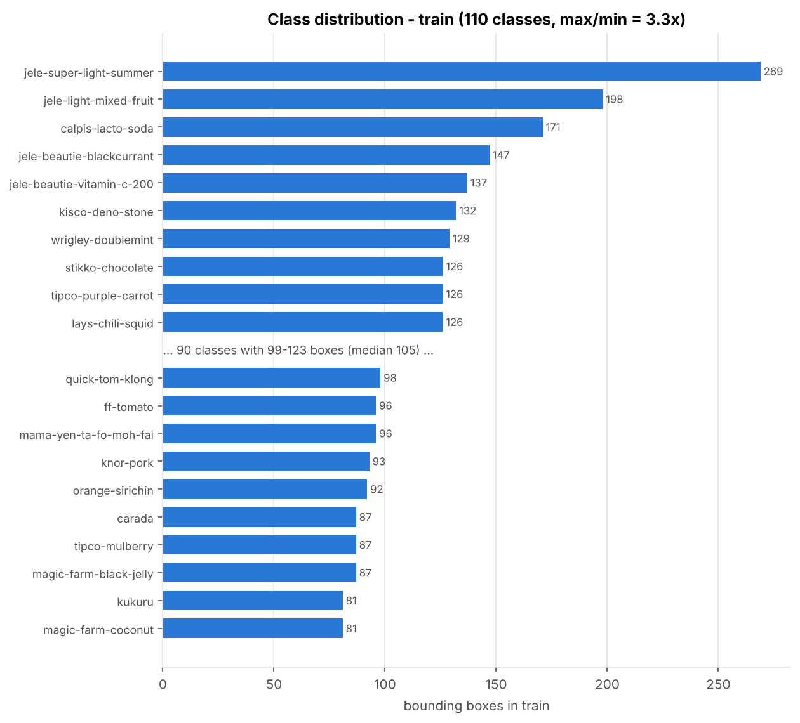
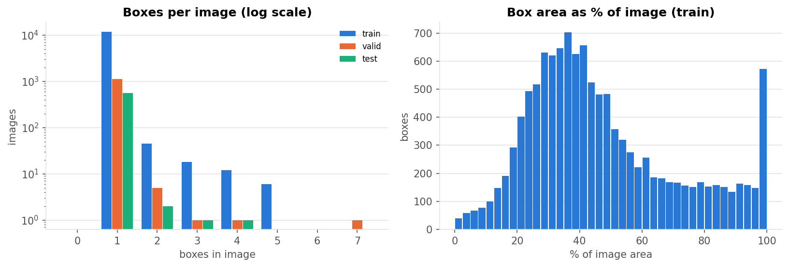

---

## ข้อ 6 — ตัวชี้วัดที่ใช้

### 6.1 ตัวชี้วัดของงาน object detection (ตัวชี้วัดหลัก)

| Metric | ความหมาย |
|---|---|
| **Precision** | ในกล่องที่โมเดลทำนาย มีสัดส่วนเท่าไรที่ถูกทั้งคลาสและตำแหน่ง (IoU ≥ 0.5) |
| **Recall** | ในกล่องจริงทั้งหมด โมเดลหาเจอเท่าไร (IoU ≥ 0.5) |
| **F1** | 2PR / (P + R) |
| **mAP@0.5** | ค่าเฉลี่ยของ AP (พื้นที่ใต้ PR curve) ทุกคลาสที่ IoU 0.5 |
| **mAP@0.5:0.95** | mAP เฉลี่ยที่ IoU 0.50, 0.55, …, 0.95 ซึ่งเข้มเรื่องความแม่นของตำแหน่งกล่อง (metric หลักของ COCO) |

P/R/F1 ระดับกล่องใช้วิธีของ Ultralytics คือคำนวณที่ IoU 0.5 ณ confidence ที่ให้ mean F1 สูงสุดของแต่ละโมเดล
(v8n 0.816, v8s 0.794) ส่วน mAP คำนวณด้วย `conf=0.001` จึงไม่ขึ้นกับ threshold

### 6.2 Accuracy และ AUC (แปลงมาจาก classification)

Accuracy และ ROC-AUC เป็น metric ของงาน classification ไม่ได้นิยามไว้ตรง ๆ สำหรับ detection
แต่เพราะรูปใน dataset นี้ส่วนใหญ่มีสินค้าชิ้นเดียว จึงแปลงเป็นงานจำแนก **ระดับรูป (image level)** ได้ดังนี้

* **label จริงของรูป** = คลาสที่มีกล่อง ground truth มากที่สุดในรูป (ถ้าเท่ากันเลือกคลาสที่กล่องรวมใหญ่กว่า)
* **คำทำนายของรูป** = คลาสของกล่องที่ confidence สูงสุด โดยต้องมี conf ≥ 0.25
  ถ้าไม่มีกล่องไหนผ่าน threshold จะนับเป็น *no detection* และถือว่าทายผิด
* **score ของคลาส c** = confidence สูงสุดของกล่องที่ทำนายเป็นคลาส c (0 ถ้าไม่มี)

จากนั้นใช้ scikit-learn คำนวณ

* **Accuracy** = สัดส่วนรูปที่ทายคลาสถูก
* **Macro Precision / Recall / F1** ระดับรูป (เฉลี่ยทุกคลาสเท่า ๆ กัน)
* **ROC-AUC แบบ one-vs-rest** = คำนวณ AUC ของแต่ละคลาสเทียบกับคลาสที่เหลือ แล้วเฉลี่ยแบบ macro (รายงานแบบ micro ด้วย)
  ROC curve วาดเองใน `results/roc_curve.png` เพราะ YOLO ไม่สร้างให้

ข้อควรระวัง

* metric ระดับรูปไม่ได้ดูตำแหน่งกล่อง และรูปที่มีสินค้าหลายชนิดจะถูกนับจากคลาสหลักคลาสเดียว จึงใช้เป็นตัวเสริม mAP
* บน dataset นี้ทั้งสองค่า **อิ่มตัว** (accuracy 566/567 ทั้งคู่) จึงแยกสองโมเดลไม่ได้ ตัวที่แยกได้คือ mAP@0.5:0.95
* score เป็น conf หลัง NMS ซึ่งแต่ละกล่องเหลือคลาสเดียว ทำให้ score ส่วนใหญ่เป็น 0 พอดี และ AUC แทบเป็น 1.0 เสมอ
* mAP มาจาก `model.val` (multi-label NMS, max_det 300) แต่ metric ระดับรูปมาจาก `model.predict` (single-label NMS)
  รูปเดียวกันจึงอาจนับว่า "หาเจอ" ใน mAP แต่เป็น no detection ในระดับรูปได้ (เกิดจริงกับรูป `milo-chocobar` ในข้อ 7.6)

### 6.3 ความเร็ว

* **ms/img (model)** = median เวลา inference ต่อรูป ไม่รวม pre/post-processing (batch = 1, ไม่นับ warm-up 10 รูปแรก)
  เลือก batch 1 เพราะกล้องในร้านส่งภาพมาทีละเฟรม และรายงาน p90 ไว้ในข้อ 7.2
* **ms/img (e2e)** = preprocess + inference + NMS วัดที่ conf 0.001 (NMS มีกล่องให้จัดการมากกว่าตอนใช้งานจริงที่ conf 0.25 เล็กน้อย)
* วัดบน Colab GPU รุ่นเดียวกันทั้งสองโมเดล (FP32, PyTorch) แต่รอบนี้ไม่ได้บันทึกชื่อ GPU
* ขนาดโมเดล: จำนวน parameters, GFLOPs ที่ 640 และขนาดไฟล์ `best.pt`

---

## ข้อ 7 — ผลการทดลอง

### 7.1 ตารางเปรียบเทียบ (test set)

<!-- AUTO:table:START -->
| Model | Box P | Box R | Box F1 | mAP50 | mAP50-95 | Img Acc | Img AUC | ms/img (model) | ms/img (e2e) | Params (M) | GFLOPs | Size (MB) |
|---|---:|---:|---:|---:|---:|---:|---:|---:|---:|---:|---:|---:|
| yolov8n | 0.973 | 0.988 | 0.980 | 0.983 | 0.969 | 0.998 | 0.999 | **7.4** | **9.7** | **3.16** | **8.9** | **6.3** |
| yolov8s | **0.984** | 0.987 | **0.986** | 0.984 | **0.977** | 0.998 | 1.000 | 14.6 | 16.6 | 11.18 | 28.9 | 21.6 |

_Box P/R/F1: IoU 0.5 ที่ confidence ซึ่งให้ mean F1 สูงสุดของแต่ละโมเดล · mAP: conf 0.001, ไม่ขึ้นกับ threshold · Img Acc/AUC: ระดับรูป, top-1 ที่ conf ≥ 0.25 · ms/img (model) = inference อย่างเดียว, (e2e) = รวม pre/post-processing, median ที่ batch 1 · ตัวหนา = ดีกว่าอย่างน้อย 0.5 pp (หรือดีกว่าสำหรับคอลัมน์ความเร็ว/ขนาด)_
<!-- AUTO:table:END -->

ไฟล์ตัวเลขทั้งหมด: `results/comparison.csv`, `results/metrics_<model>.json`, `results/per_class_<model>.csv`

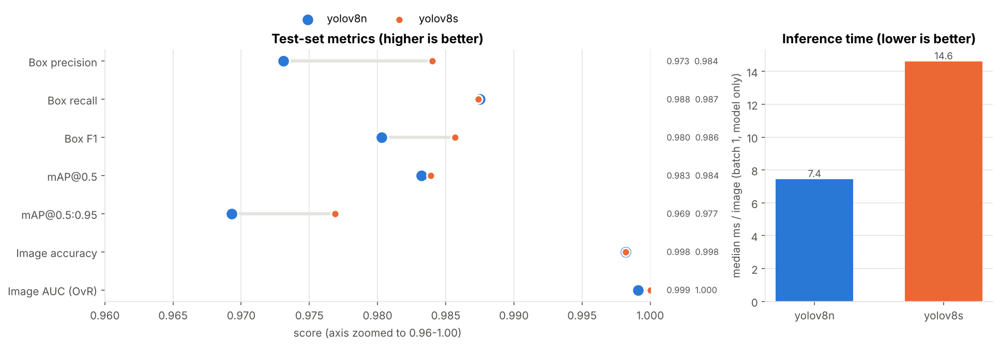

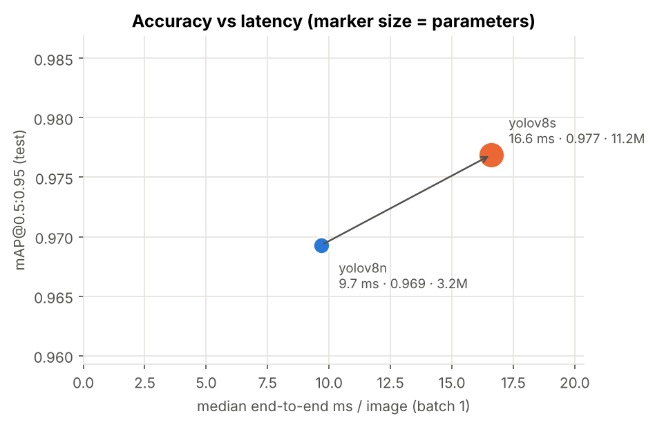

### 7.2 ข้อค้นพบเชิงตัวเลข

<!-- AUTO:findings:START -->
- **yolov8s** เทียบกับ **yolov8n** (pp = จุดเปอร์เซ็นต์ บนสเกล 0-100): mAP50-95 +0.76 pp, mAP50 +0.07 pp, box precision +1.09 pp, box recall -0.01 pp, accuracy ระดับรูป +0.00 pp
- ต้นทุน: yolov8s ใช้เวลา inference (median) **1.97 เท่า** (7.4 -> 14.6 ms/รูป), end-to-end 1.71 เท่า, parameters 3.5 เท่า, ไฟล์ใหญ่ 3.4 เท่า
- latency p90 (model only): yolov8n 10.6 ms, yolov8s 15.1 ms = 1.43 เท่า (ที่ median 1.97 เท่า)
- ทดสอบแบบจับคู่รายคลาส (110 คลาส, test set และ checkpoint ชุดนี้): AP50-95 yolov8s ดีกว่า 24 / แย่กว่า 8 / เท่ากัน 78 คลาส, Wilcoxon p = 0.0013, sign test p = 0.0070, bootstrap 95% CI ของค่าเฉลี่ย +0.30 ถึง +1.30 pp · AP50: 2/1/107, Wilcoxon p = 0.59 (ไม่ต่างกัน)
- รูปที่ไม่มีกล่องไหน conf >= 0.25 (no detection): yolov8n 0.18%, yolov8s 0.18%
- รูปใน test set (ระดับรูป): ถูกเฉพาะ yolov8n = 0, ถูกเฉพาะ yolov8s = 0, ผิดทั้งคู่ = 1, ถูกทั้งคู่ = 566 → ไม่มีรูปที่สองโมเดลให้ผลต่างกัน (McNemar ไม่มีข้อมูลให้ทดสอบ)
<!-- AUTO:findings:END -->

**การรันประเมินซ้ำ (รอบที่ 2 บน Colab, weights เดิม, โค้ดประเมินเดิม):** คำทำนายและ confidence ของทุกรูปตรงกับรอบแรกทุกตำแหน่ง
ตัวชี้วัดความแม่นทุกตัวจึงเท่าเดิม แปลว่าการประเมินทำซ้ำได้ ส่วนเวลาแกว่งตามเครื่อง: median ms/img (model) 7.04 / 14.48
(รอบแรก 7.43 / 14.60) = **2.06 เท่า** (รอบแรก 1.97), end-to-end 1.80 เท่า (รอบแรก 1.71), p90 10.0 / 15.1 ms
ข้อสรุปว่า v8s ช้ากว่าเกือบ 2 เท่าจึงคงเดิม (ตัวเลขรอบที่ 2: `results/comparison_rerun2.csv`)

### 7.3 กราฟ

| | |
|---|---|
| mAP และ box loss บน valid ต่อ epoch | 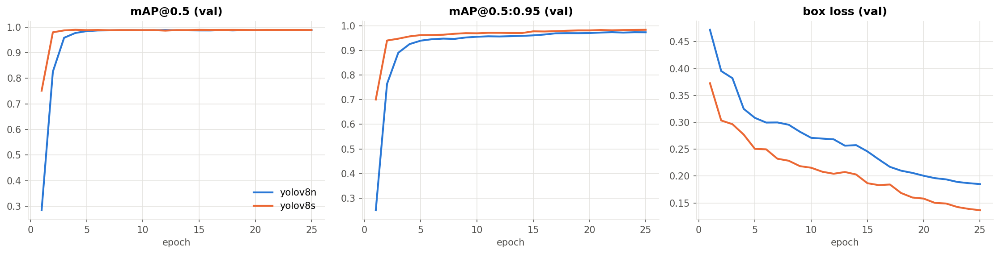 |
| loss ของ train และ valid (Ultralytics) | 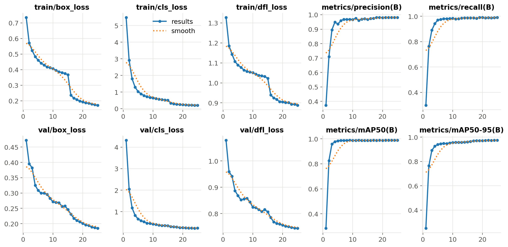 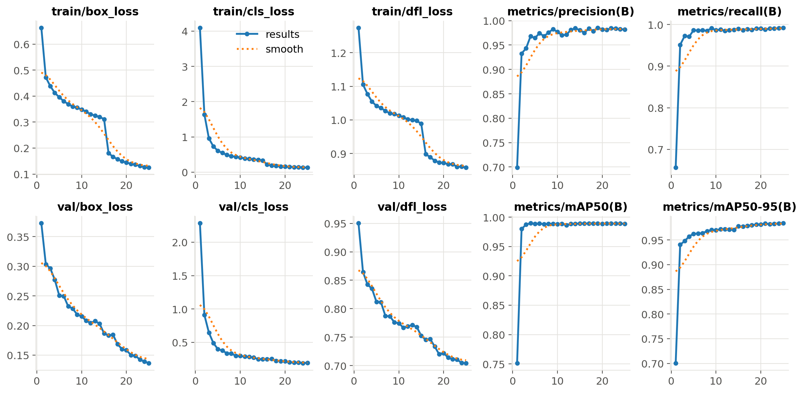 |
| AP@0.5:0.95 รายคลาส v8n เทียบ v8s | 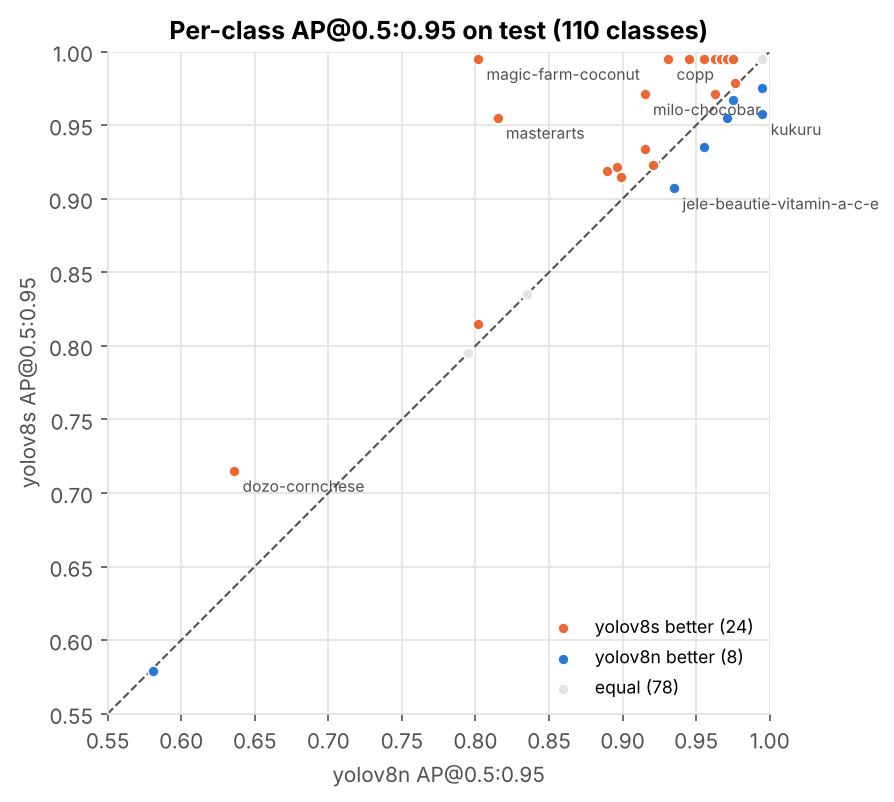 |
| ROC ระดับรูป (one-vs-rest) | 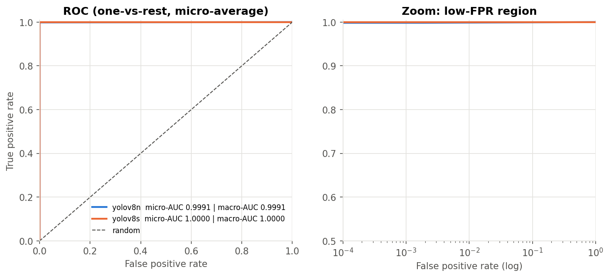 |
| PR curve (YOLOv8s) | 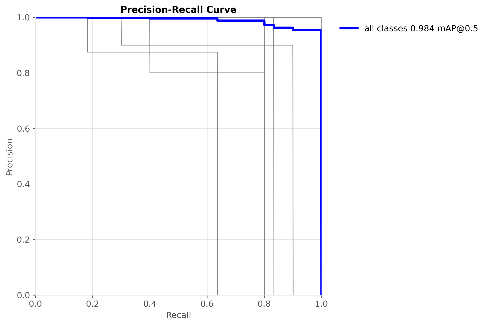 |
| F1–confidence (YOLOv8s) | 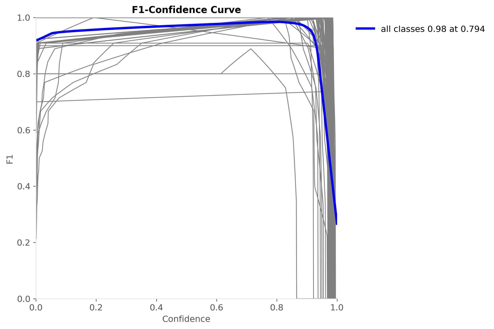 |

* `results/<model>_results.png` แสดงว่า loss ของ train และ valid ลดลงไปด้วยกันตลอด 25 epoch จึงไม่มีสัญญาณ overfitting
  และ mAP@0.5:0.95 บน valid ยังขึ้นเล็กน้อยในช่วงท้าย (ยังไม่อิ่มตัว)
* ROC อยู่ชิดมุมบนซ้ายทั้งสองเส้นเพราะ score อิ่มตัว (ข้อ 6.2) ค่า AUC ที่ไม่ใช่ 1 มีที่เดียวคือคลาส `milo-chocobar` ของ v8n (0.9)
  ซึ่งมาจากรูปที่ v8n ไม่ให้ score คลาส milo เลย (score = 0 เสมอกับรูปอื่น)

### 7.4 คลาสที่สับสนกัน

<!-- AUTO:confusions:START -->
**ระดับรูป (top-1 ที่ conf ≥ 0.25):** ไม่มีการทายสลับคลาสเลย ความผิดพลาดมีแค่ no detection: yolov8n 1 รูป, yolov8s 1 รูป
<!-- AUTO:confusions:END -->

**เกี่ยวกับ `results/<model>_confusion_matrix_normalized.png`:** ภาพนี้เป็น confusion matrix ระดับกล่องที่ Ultralytics วาดตอน `val`
ซึ่งคำนวณที่ conf 0.001 คู่กับ multi-label NMS กล่องที่ conf ต่ำมากแต่ผิดคลาสจึง "แย่ง" ground truth ไปได้
ช่องนอกแนวทแยงที่เห็น (เช่น wrigley-doublemint → milo-chocobar ใน v8n) **ไม่ใช่การทายผิดจริง** (wrigley-doublemint มี box recall 1.0)
และเมื่อมี ≥ 100 คลาส Ultralytics วาดแค่ทุกคลาสที่ 2 (55 จาก 110) จึงไม่ควรอ่าน class swap จากภาพนี้
`src/evaluate.py` เวอร์ชันนี้คำนวณ confusion matrix ใหม่ที่ conf 0.25 ครบ 110 คลาสเป็น CSV (ต้องรันใหม่ ดูข้อ 8)

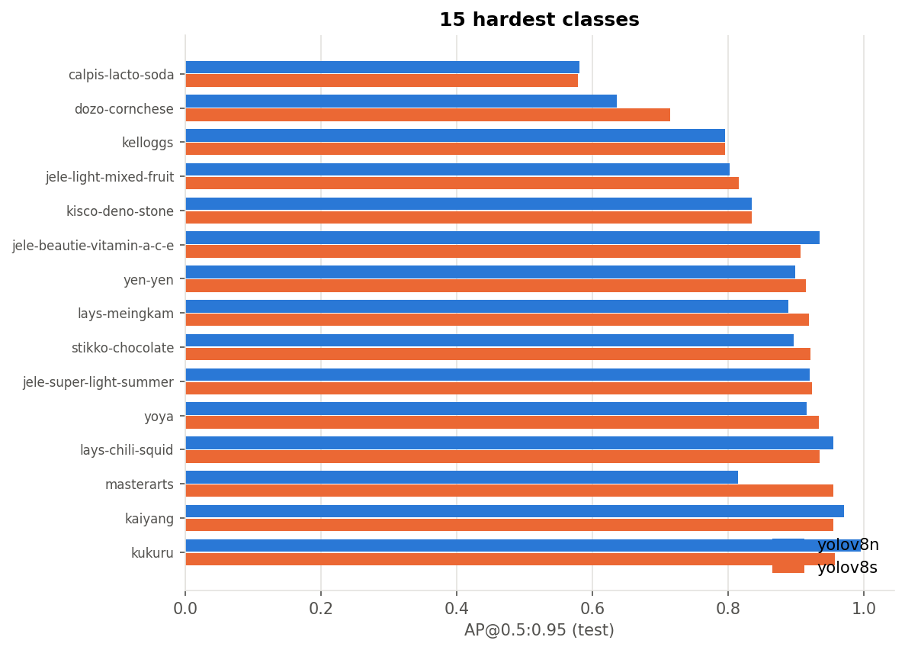

<!-- AUTO:hardest:START -->
10 คลาสที่ AP50-95 ต่ำที่สุดของ **yolov8s** (test set). box P/R = ระดับกล่องที่ IoU 0.5 ณ conf ที่ให้ mean F1 สูงสุด, img recall = ระดับรูป:

| class | test img | test box | box P | box R | AP50 | AP50-95 | AP50-95 (yolov8n) | img recall |
|---|---|---|---|---|---|---|---|---|
| calpis-lacto-soda | 8 | 11 | 0.858 | 0.636 | 0.579 | 0.579 | 0.581 | 1.0 |
| dozo-cornchese | 5 | 5 | 0.8 | 0.8 | 0.715 | 0.715 | 0.636 | 1.0 |
| kelloggs | 5 | 5 | 1.0 | 0.661 | 0.795 | 0.795 | 0.795 | 1.0 |
| jele-light-mixed-fruit | 10 | 10 | 0.9 | 0.9 | 0.835 | 0.815 | 0.802 | 1.0 |
| kisco-deno-stone | 5 | 6 | 1.0 | 0.833 | 0.835 | 0.835 | 0.835 | 1.0 |
| jele-beautie-vitamin-a-c-e | 5 | 5 | 0.989 | 1.0 | 0.995 | 0.907 | 0.935 | 1.0 |
| yen-yen | 5 | 5 | 1.0 | 1.0 | 0.995 | 0.915 | 0.899 | 1.0 |
| lays-meingkam | 5 | 5 | 1.0 | 1.0 | 0.995 | 0.919 | 0.889 | 1.0 |
| stikko-chocolate | 5 | 8 | 0.994 | 1.0 | 0.995 | 0.922 | 0.896 | 1.0 |
| jele-super-light-summer | 12 | 12 | 1.0 | 1.0 | 0.995 | 0.923 | 0.92 | 1.0 |
<!-- AUTO:hardest:END -->

### 7.5 ตัวอย่างที่ทายถูก / ทายผิด

กรอบเขียว = ground truth, กรอบแดงเส้นประ = คำทำนาย top-1 (conf ≥ 0.25) และหัวข้อแต่ละรูปบอก label จริงกับ label ที่ทาย

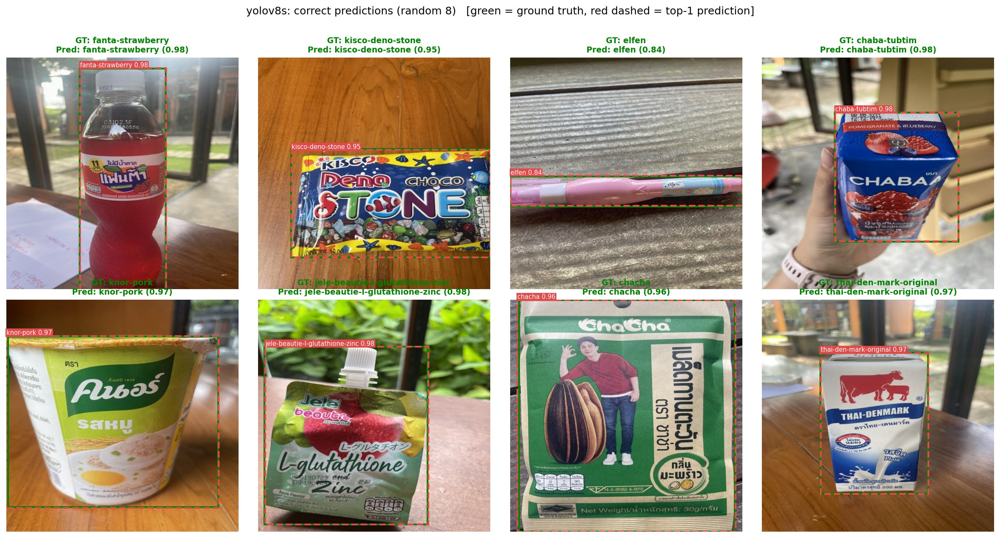

**ทายผิดระดับรูป:** ทั้ง test set มีแค่ **1 รูป** และเป็นรูปเดียวกันทั้งสองโมเดล คือ `milo-chocobar` ที่ถืออยู่ในมือ
โดยพื้นหลังมีห่อขนมสีสดหลายชิ้น ทั้งสองโมเดลไม่ให้กล่องไหนมี conf ถึง 0.25

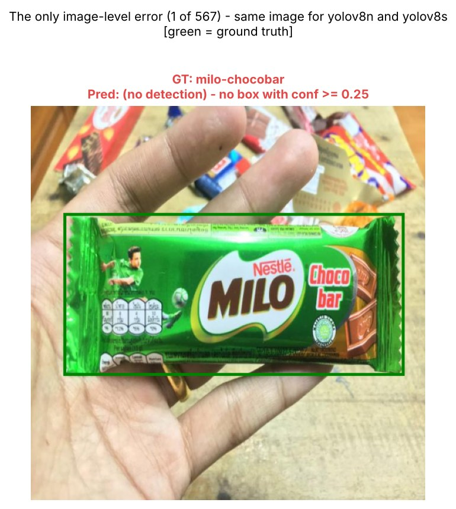

**ผิดระดับกล่อง:** ความผิดพลาดที่เหลือ (กล่องที่หาไม่เจอในรูปหลายชิ้น, กล่องที่ IoU < 0.5) เกิดในระดับกล่องและไม่เห็นจาก metric ระดับรูป
รอบนี้ยังไม่ได้วาดเพราะไม่ได้เก็บตำแหน่งกล่องที่ทำนายไว้ `src/evaluate.py` เวอร์ชันนี้จะวาด `results/examples_box_errors_<model>.jpg`
และนับแยกประเภทให้เมื่อรันใหม่

<!-- AUTO:boxerrors:START -->
_ยังไม่มีข้อมูล: ต้องรัน notebook ใหม่ (เฉพาะส่วนประเมิน) ด้วย src/evaluate.py เวอร์ชันนี้ จึงจะได้ results/box_errors_<model>.csv และ examples_box_errors_<model>.jpg_
<!-- AUTO:boxerrors:END -->

### 7.6 การวิเคราะห์

1. **ภาพรวม: ทั้งสองโมเดลเกือบสมบูรณ์** – mAP@0.5 ≈ 0.983–0.984, mAP@0.5:0.95 ≈ 0.97–0.98 และ accuracy ระดับรูป
   566/567 = 0.998 (95% CI แบบ Wilson: 0.990–0.9997) ใกล้เคียงโมเดลที่ Roboflow เทรนไว้บนหน้า dataset (~99% mAP@0.5)
   เหตุผลหลักคือข้อมูลง่าย (สินค้าชิ้นเดียวต่อรูป กล่องใหญ่) และ test มีภาพที่ถ่ายต่อเนื่องกับภาพใน train (ข้อ 7.7)
   Accuracy และ AUC ระดับรูปอิ่มตัวทั้งคู่ จึงใช้แยกสองโมเดลไม่ได้
2. **v8s ดีกว่าเฉพาะความแม่นของกรอบ** – mAP@0.5 ต่างกันแค่ +0.07 pp แต่ mAP@0.5:0.95 ต่าง +0.76 pp
   และ box precision ต่าง +1.1 pp ที่ recall เท่ากัน (~0.987) ความจุที่มากกว่าจึงช่วยให้ **กรอบแนบขึ้นและมีกล่องเกินน้อยลง**
   แต่ไม่ได้ช่วยการจำแนกคลาสในระดับรูป เมื่อทดสอบแบบจับคู่รายคลาส (110 คลาส) AP@0.5:0.95 ของ v8s ดีกว่าใน 24 คลาส
   แย่กว่าใน 8 และเท่ากันใน 78 (Wilcoxon p = 0.0013, sign test p = 0.007, bootstrap 95% CI ราว +0.3 ถึง +1.3 pp)
   ส่วน AP@0.5 ไม่ต่างกัน (p = 0.59) ข้อควรระวังคือ 5 คลาสให้ส่วนต่างเกือบ 2 ใน 3
   (`magic-farm-coconut` +19 pp, `masterarts` +14 pp, `dozo-cornchese` +8 pp, `copp` +6 pp, `milo-chocobar` +6 pp)
   ถ้าตัดออกเหลือ +0.28 pp การทดสอบนี้บอกความสม่ำเสมอบน test set และ checkpoint ชุดนี้เท่านั้น
   ยังไม่ได้วัดความแปรปรวนระหว่างการเทรนคนละ seed
   ระหว่างเทรน v8s ถึง mAP@0.5 ≈ 0.98 ตั้งแต่ epoch 2 ขณะที่ v8n ใช้ราว 5 epoch ทั้งสองยังไม่อิ่มตัวที่ epoch 25
   ส่วนต่างจึงอาจเปลี่ยนถ้าเทรนนานขึ้น
3. **ความแม่น vs ความเร็ว: v8n คุ้มกว่าสำหรับงานจำแนกทีละชิ้น** – v8s ใช้เวลา inference (median) **1.97 เท่า** (7.4 → 14.6 ms/รูป; วัดซ้ำได้ 2.06 เท่า)
   หรือ 1.71 เท่าเมื่อรวม pre/post-processing (9.7 → 16.6 ms) ที่ p90 ต่างกันแค่ 1.43 เท่า (10.6 → 15.1 ms) เพราะเวลาของ v8n แกว่งกว่า
   parameters 3.5 เท่า, GFLOPs 3.2 เท่า, ไฟล์ใหญ่ 3.4 เท่า (6.3 → 21.6 MB) และ **ในระดับรูปทายถูก/ผิดชุดเดียวกันทุกรูป**
   สำหรับเคาน์เตอร์หรือ self-checkout ที่ถ่ายสินค้าทีละชิ้น v8n ให้ผลระดับรูปเท่ากันด้วยเวลาราวครึ่งเดียว
   และคาดว่าจะรันบนอุปกรณ์ edge ได้ง่ายกว่าจากจำนวน parameters/GFLOPs (ยังไม่ได้วัดบน CPU หรืออุปกรณ์ edge จริง)
   v8s จะคุ้มเมื่อกรอบต้องแม่น เช่น นับสินค้าหรือวัดพื้นที่บนชั้นวาง
4. **คลาสที่ยากเสีย AP ที่ IoU 0.5 ไม่ใช่เพราะกรอบหลวม** – 4 ใน 5 คลาสที่ AP@0.5:0.95 ต่ำสุดของ v8s มี AP@0.5 = AP@0.5:0.95 พอดี
   (`calpis-lacto-soda` 0.58, `dozo-cornchese` 0.72, `kelloggs` 0.80, `kisco-deno-stone` 0.84) แปลว่ากล่องที่เจอแนบอยู่แล้ว (IoU ≥ 0.95)
   และ AP ที่หายไปมาจากกล่องที่ไม่ถูกนับว่าเจอแม้ที่ IoU 0.5 สาเหตุแยกได้ 2 แบบ
   * **รูปที่มีหลายชิ้น** (`calpis-lacto-soda`, `kisco-deno-stone`) – ทุกรูปของสองคลาสนี้ทายคลาสระดับรูปถูก (v8s ที่ conf ≥ 0.9)
     แต่ box recall ของ calpis เป็น 7/11 และ kisco 5/6 จากตัวเลขรายคลาสอนุมานได้ว่ากล่องที่หาไม่เจอส่วนใหญ่อยู่ใน 4 รูปที่มีหลายชิ้น
     เป็นข้อบ่งชี้จากแค่ 4 รูป และ `stikko-chocolate` (รูป 4 กล่อง) ก็หาเจอครบ ต้องยืนยันด้วยการนับระดับกล่อง (ข้อ 8)
   * **รูปชิ้นเดียวที่กรอบผิดที่** (`dozo-cornchese`, `kelloggs`) – ทุกรูปเป็นชิ้นเดียวและทายคลาสถูก
     (dozo ที่ conf 0.96–0.98, kelloggs 0.69–0.85) แต่ dozo มี box P = R = 0.80 (AP@0.5 = 0.715 ต่ำกว่า 4/5
     เพราะกล่องที่ผิดที่มี conf สูง) และ kelloggs มี AP@0.5 = 0.795 ≈ 4/5 แปลว่าแต่ละคลาสมีราว 1 กล่องที่ IoU < 0.5
     อาจเป็นกรอบที่ผิดตำแหน่งมากหรือ label ของ ground truth ผิด ควรเปิดดูรูปเหล่านี้ (ข้อ 8)
     ส่วน kelloggs ยังมี conf ต่ำกว่าคลาสอื่น จึงหลุด threshold 0.794 ทำให้ box recall เหลือ 0.66
   * กลุ่มที่ AP@0.5 = 0.995 แต่ AP@0.5:0.95 ราว 0.90–0.92 (`yen-yen`, `lays-meingkam`, `stikko-chocolate`, `jele-beautie-vitamin-a-c-e`)
     คือกลุ่มที่ปัญหาเป็นความแนบของกรอบจริง
5. **สิ่งที่คาดไว้แต่ไม่เห็นในผล** –
   * ไม่พบการทายสลับระหว่าง **สินค้าแบรนด์เดียวกันต่างรส** (`lays-*`, `jele-beautie-*`, `taro-*`) **ในระดับรูป**
     ส่วนระดับกล่องยังบอกไม่ได้จนกว่าจะได้ confusion matrix ที่ conf 0.25 (ข้อ 7.4)
   * **คลาสที่ข้อมูลน้อยไม่ได้ยากกว่า** – 5 คลาสที่ยากที่สุดของ v8s มีกล่องใน train 105–198 กล่อง ไม่ได้อยู่กลุ่มที่น้อยที่สุด (81–87 กล่อง)
     และ 10 คลาสที่ยากที่สุดยังรวม `jele-super-light-summer` ซึ่งมีกล่องมากที่สุด (269)
     Spearman ระหว่างจำนวนกล่องใน train กับ AP@0.5:0.95 เป็นลบด้วยซ้ำ (v8n −0.23, p = 0.017; v8s −0.27, p = 0.005)
     ถ้าตัด 3 คลาสที่มีรูปหลายชิ้นออก ค่าลดเหลือ −0.15 / −0.17 และไม่มีนัยสำคัญ (p = 0.13 / 0.08)
     มีเพียง `magic-farm-coconut` (81 กล่อง) ที่ v8n ทำได้ 0.80 ขณะที่ v8s ทำได้ 0.995
   * ไม่มีหลักฐานในระดับรูปว่า horizontal flip ทำให้สับสนเรื่องตัวหนังสือบนแพ็กเกจ
6. **รูปเดียวที่ผิด** (`milo-chocobar`) เป็นการหาไม่เจอ ไม่ใช่การทายเป็นคลาสอื่น และเป็นภาพจากแหล่งอื่น
   (ชื่อไฟล์แบบ UUID ไม่ใช่ `IMG_xxxx` จากกล้องชุดหลัก) ซึ่งสอดคล้องกับข้อ 7.7: ภาพชื่อ `IMG_` ทายถูก 533/533
   ภาพจากแหล่งอื่น (`LINE_ALBUM_*` 33 รูป + UUID 1 รูป) ทายถูก 33/34 ในระดับกล่อง `model.val` ยังนับว่าหาเจอ (AP@0.5 ของ milo = 0.995 ทั้งคู่) เพราะมีกล่อง milo ที่ conf ต่ำกว่า 0.25
   ส่วนระดับรูป v8n ไม่ให้ score คลาส milo กับรูปนี้เลย (AUC ของ milo = 0.9 มาจากค่า 0 ที่เสมอกับรูปอื่น)
   ขณะที่ v8s ให้ score milo ต่ำ ๆ ที่ยังสูงกว่ารูปอื่นทั้งหมด (AUC 1.0) ส่วนต่าง AUC 0.9991 กับ 1.0 จึงมาจากรูปนี้รูปเดียว
   การลด threshold อาจช่วย v8s ได้แต่ช่วย v8n ไม่ได้

**ข้อเสนอแนะต่อยอด:** (1) ทดสอบกับภาพชั้นวางจริงที่มีหลายชิ้น หรือแบ่ง test ใหม่ตามชุดภาพ (ไม่สุ่มรายรูป)
(2) เทรนนานกว่า 25 epoch (เช่น 50–100 กับ patience 10–20) และหลาย seed เพื่อดูว่าส่วนต่าง v8n/v8s คงอยู่หรือไม่
(3) วัดความเร็วบน CPU / FP16 / ONNX ก่อนสรุปเรื่องอุปกรณ์ edge

### 7.7 ข้อจำกัด

* **ภาพใน test น่าจะเป็นเฟรมถ่ายต่อเนื่องกับภาพใน train (near-duplicate leakage):** Roboflow แบ่ง split แบบสุ่มรายรูป
  แต่ภาพถ่ายเป็นชุด (burst) ทีละสินค้า ชื่อไฟล์ใน test 530/567 รูปเป็น `IMG_<เลขเฟรม>` เมื่อเรียงตามคลาส มี 51 คู่ที่เลขเฟรมติดกัน (ห่าง 1)
  36% ห่างไม่เกิน 3 เฟรม และ median ห่าง 6 เฟรม เช่น `masterarts` มีเฟรม IMG_2809, 2811, 2812, 2842 ใน test (และภาพ LINE_ALBUM อีก 1 รูป)
  เฟรมที่อยู่ระหว่างนั้น (เช่น IMG_2810) จึง **น่าจะ** อยู่ใน train หรือ valid ค่า AP@0.5 = AP@0.5:0.95 ใน 82 (v8n) / 93 (v8s) จาก 110 คลาส
  ก็สอดคล้องกับการเจอภาพที่เกือบซ้ำ ตัวเลขทั้งหมดจึง **น่าจะสูงกว่าบนภาพใหม่** และรูปเดียวที่ผิดมาจากแหล่งที่ไม่ใช่ burst (ข้อ 7.6 ข้อ 6)
  ยืนยันได้ด้วย `near_duplicate_check` (ข้อ 8) และแก้ได้ด้วยการแบ่ง split ตามชุดภาพแล้วเทรนใหม่
* **Domain gap:** รูปเป็นสินค้า **ทีละชิ้นถ่ายใกล้ ๆ** (เฉลี่ย 1.01 กล่องต่อรูป, กล่องกินพื้นที่ ~40% ของภาพ) ไม่ใช่ภาพชั้นวาง
  ที่มีสินค้าเรียงแน่น ซ้อนกัน หรือถูกบัง ผลที่ได้จึง**ไม่สะท้อนประสิทธิภาพบนชั้นวางจริง** และข้อ 7.6 ชี้ว่ารูปที่มีหลายชิ้นอาจเป็นจุดอ่อน
* **Test set เล็ก** (567 รูป, ~5 รูปต่อคลาส) ผิด 1 รูปเท่ากับ accuracy ลด 0.18 pp และ metric รายคลาสมีความไม่แน่นอนสูง
* **เทรนครั้งเดียว 25 epoch** (seed 0) ยังไม่อิ่มตัว และยังไม่ได้วัดความแปรปรวนระหว่าง seed
* **Version 3 มีรูปที่ augment ไว้ล่วงหน้า** ใน train อยู่แล้ว เมื่อเทรนก็ใช้ augmentation ของ YOLO ซ้ำอีกชั้น
* **Closed-set:** โมเดลรู้จักแค่ 110 คลาส สินค้าใหม่หรือแพ็กเกจที่เปลี่ยนดีไซน์จะถูกทายเป็นคลาสที่ใกล้ที่สุด
* **Accuracy/AUC ระดับรูป** เป็นการแปลงจาก detection (ข้อ 6.2) อิ่มตัวบน dataset นี้ และใช้ NMS คนละแบบกับ mAP
* **บันทึกการทดลองไม่ครบ** – รอบนี้ไม่ได้เก็บชื่อ GPU, เวลาเทรน, log ต่อ epoch (`results.csv`) และตำแหน่งกล่องที่ทำนาย (ข้อ 8)

---

## ข้อ 8 — สิ่งที่ยังต้องรันเพิ่ม (ต้องใช้ Colab / Google Drive)

โค้ดใน repo เวอร์ชันนี้รองรับทุกข้อแล้ว **ไม่ต้องเทรนใหม่**: เปิด notebook บน Colab แล้ว Run all
ถ้า `runs/` ยังอยู่ใน Google Drive ขั้นเทรนจะถูกข้าม และจะได้ข้อ 1–4 อัตโนมัติ (~10–15 นาทีบน T4)

> ต้องใช้ notebook เวอร์ชันใหม่: ปิดแท็บ Colab เก่า เปิดจากลิงก์ในหัวข้อ "วิธีรัน" ใหม่ และถ้า Colab ยังจำ session เดิม
> ให้กด *Runtime → Disconnect and delete runtime* ก่อน Run all ถ้า `results.zip` ที่ได้ยังมีไฟล์ `README.generated.md`
> หรือไม่มี `box_errors_<model>.csv` แปลว่ายังรันด้วยโค้ดเก่า (รอบที่ 2 ที่บันทึกไว้ใน 7.2 เป็นแบบนั้น)

1. **ความผิดพลาดระดับกล่อง** – `results/box_errors_<model>.csv`, `examples_box_errors_<model>.jpg` และ box recall
   แยกระหว่างรูปชิ้นเดียวกับรูปหลายชิ้น เพื่อยืนยันข้อ 7.6 ข้อ 4
2. **Confusion matrix ที่ conf 0.25** ครบ 110 คลาส (`confusion_matrix_conf0.25_<model>.csv`, `box_confusions_<model>.csv`)
   เพื่อตอบว่ามีการสลับคลาสระดับกล่องในสินค้าแบรนด์เดียวกันหรือไม่
3. **บันทึกการทดลอง** – optimizer/lr ที่ใช้จริง, epoch ที่ดีที่สุด, เวลาเทรน (`metrics_<model>.json`), ชื่อ GPU และเวอร์ชันแพ็กเกจ
   (`run_info.json`), log ต่อ epoch (`<model>_results.csv`) ซึ่งทำให้วาดกราฟ train vs val loss ใหม่ได้
4. **ตรวจ leakage จากชื่อไฟล์** – `results/near_duplicates.csv`: แต่ละรูปใน test มีเฟรมติดกันของคลาสเดียวกันใน train หรือไม่
5. (ถ้ามีเวลา) เทรนนานขึ้นหลาย seed และแบ่ง split ตามชุดภาพ เพื่อวัดผลบนภาพที่ไม่ซ้ำกับ train

---

## วิธีรัน

1. สมัคร Roboflow (ฟรี) แล้วเอา API key จาก *Settings → API Keys*
2. เปิด notebook ใน Colab: <https://colab.research.google.com/github/ToonRz/retail-shelf-detection/blob/main/notebooks/train_eval.ipynb>
   แล้วเลือก *Runtime → Change runtime type → T4 GPU*
3. ใส่ API key ได้ 2 ทาง: เพิ่ม secret `ROBOFLOW_API_KEY` (ไอคอนกุญแจทางซ้าย แล้วเปิด Notebook access)
   หรือไม่ต้องตั้งอะไร แล้ววาง key ในช่องที่ notebook ขึ้นมาถาม
4. *Runtime → Run all* โดย notebook จะทำตามลำดับ: โหลดข้อมูล → EDA → เทรน v8n, v8s (ข้ามถ้าเคยเทรนแล้ว) → ประเมิน → อัปเดต README
5. ดาวน์โหลด `results.zip` แล้วแตกไฟล์ที่ root ของ repo (`unzip -o results.zip`) จะได้ `results/` และ `README.md` ใหม่ แล้ว commit
   (หรือ push จาก Colab: ตั้ง `PUSH = True` ใน cell สุดท้ายและเพิ่ม secret `GITHUB_TOKEN`)
6. ถ้า Colab หลุดระหว่างเทรน ให้กด Run all ใหม่ โมเดลที่เทรนเสร็จแล้วจะถูกข้าม และโมเดลที่ค้างจะเทรนต่อจาก `last.pt` ใน Drive

รันบนเครื่องตัวเองหรือรันแยกขั้นตอน (ต้องมี GPU สำหรับเทรน และต้องมี `best.pt` สำหรับประเมิน):

```bash
pip install -r requirements.txt
cp .env.example .env              # ใส่ ROBOFLOW_API_KEY
python -c "import sys; sys.path.insert(0, 'src'); from data import download_dataset, fix_data_yaml; fix_data_yaml(download_dataset(3, 'datasets/sell-products'))"
# เทรนด้วย notebook หรือ copy ทั้งโฟลเดอร์ MyDrive/retail-shelf-detection/runs/detect/<model>/ จาก Drive
# (weights/best.pt + results.csv + args.yaml) มาไว้ที่ runs/detect/<model>/
python src/evaluate.py --data datasets/sell-products/data_abs.yaml \
    --weights runs/detect/yolov8n/weights/best.pt runs/detect/yolov8s/weights/best.pt --out results
python src/make_report.py         # เติมตัวเลขลง README
python src/evaluate.py --replot   # วาดกราฟที่ใช้แค่ CSV ใหม่ (ไม่ต้องมี dataset หรือ GPU)
```

## โครงสร้าง repo

```
retail-shelf-detection/
├── notebooks/train_eval.ipynb   # pipeline ทั้งหมด (Colab/Kaggle)
├── src/
│   ├── data.py                  # ดาวน์โหลด Roboflow, แก้ data.yaml, อ่าน label, EDA, ตรวจภาพซ้ำข้าม split
│   ├── evaluate.py              # detection metrics, image-level accuracy/AUC/ROC, box-level errors, กราฟ, ตัวอย่างถูก/ผิด
│   ├── make_report.py           # เติมตาราง/ข้อค้นพบ/การทดสอบทางสถิติลง README
│   └── plotstyle.py             # สี/สไตล์กราฟ
├── results/                     # .csv + .png/.jpg ที่ใช้ในรายงาน (commit ได้)
├── requirements.txt
├── .env.example                 # template ของ API key (.env ไม่ถูก commit)
└── .gitignore                   # datasets/, runs/, *.pt, .env
```
