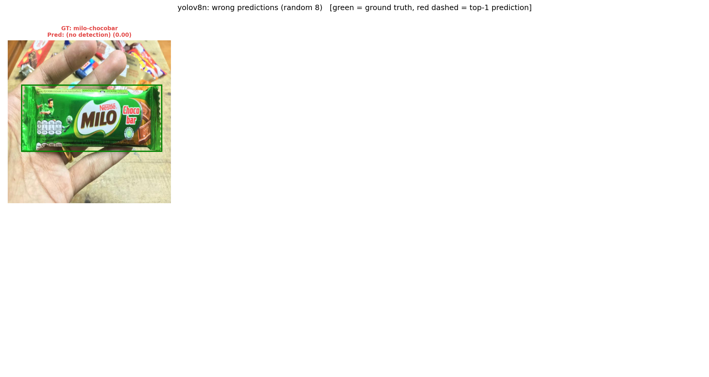

# retail-shelf-detection

ตรวจจับและจำแนกสินค้าในร้านค้าปลีก (110 คลาส) ด้วย **YOLOv8n เทียบกับ YOLOv8s**
ใช้ transfer learning จาก weights ที่ pretrain บน COCO แล้ว fine-tune บน dataset *Sell Products* ของ O2O Minimart

> **สถานะ:** โค้ด, notebook และโครงรายงานเสร็จแล้ว ส่วนตัวเลขในข้อ 7 (ช่อง `AUTO`) จะถูกเติมอัตโนมัติ
> เมื่อรัน `notebooks/train_eval.ipynb` จบ (เซลล์ "อัปเดต README" เรียก `src/make_report.py` ให้)

---

## Dataset

| | |
|---|---|
| ชื่อ | Sell Products – O2O Minimart (Roboflow Universe) |
| ลิงก์ | <https://universe.roboflow.com/o2o-minimart/sell-products> |
| งาน | Object detection, 110 คลาส (เช่น `pepsi`, `lays-salt`, `mama-pork`, `taro-original`) |
| ขนาด | 8,988 รูปต้นฉบับ; version 3 มี 13,560 รูป (รวมรูปที่ augment แล้วใน train) |
| Split | ใช้ train / valid / test ตามที่ Roboflow แบ่งไว้ (test ไม่ถูกใช้ระหว่างเทรน) |
| License | **CC BY 4.0** – ใช้ได้โดยต้องอ้างอิงแหล่งที่มา |

```bibtex
@misc{sell-products_dataset,
  title        = {Sell Products Dataset},
  author       = {O2O Minimart},
  howpublished = {\url{https://universe.roboflow.com/o2o-minimart/sell-products}},
  journal      = {Roboflow Universe},
  publisher    = {Roboflow},
  note         = {License: CC BY 4.0}
}
```

ไม่มีการ commit ตัว dataset, weights (`*.pt`) หรือ API key ลง repo (ดู `.gitignore`)

---

## ข้อ 5 — ขั้นตอนการทดลอง

1. **ดึงข้อมูล** – ใช้ Roboflow API export เป็นฟอร์แมต `yolov8` (`src/data.py: download_dataset`)
   API key อ่านจาก Colab/Kaggle secret หรือ `.env` เท่านั้น จากนั้นเขียน `data_abs.yaml` ใหม่ด้วย absolute path
   เพราะ `data.yaml` ของ Roboflow ใช้ path แบบ `../train/images` ซึ่งมักชี้ผิดที่
2. **EDA** (`src/data.py: run_eda`) – นับรูป/กล่องต่อ split, จำนวนกล่องต่อคลาส (ดูความไม่สมดุลของคลาส),
   จำนวนกล่องต่อรูป และขนาดกล่องเทียบกับรูป
3. **Preprocessing** – letterbox resize เป็น 640×640, normalize เป็น 0–1 และใช้ augmentation ของ YOLO ระหว่างเทรน:
   mosaic (ปิดใน 10 epoch สุดท้าย), horizontal flip 0.5, HSV jitter (h 0.015, s 0.7, v 0.4), scale 0.5, translate 0.1
4. **โมเดล** – YOLOv8n (~3M params, เน้นเร็ว) กับ YOLOv8s (~11M params, เน้นแม่น) ทั้งคู่เริ่มจาก COCO weights
   แล้วเปลี่ยน detection head เป็น 110 คลาส (transfer learning)
5. **เทรน** – config เดียวกันทั้งสองตัวเพื่อให้เทียบกันได้แฟร์:
   `epochs=25, imgsz=640, batch=16, patience=5 (early stopping), seed=0, deterministic=True`, optimizer `auto`
   เทรนบน Google Colab T4 (หรือแยก v8n/v8s ไปรัน Colab กับ Kaggle พร้อมกัน), เก็บ `runs/` ไว้ใน Google Drive กันหลุด
6. **ประเมิน** – ใช้ `best.pt` (mAP ดีที่สุดบน valid) ไปรันบน **test set** ซึ่งไม่ได้ใช้ตอนเทรนหรือเลือกโมเดล
   (`src/evaluate.py`)

### ผล EDA

<!-- AUTO:eda:START -->
_(จะถูกเติมหลังรัน notebook)_
<!-- AUTO:eda:END -->


---

## ข้อ 6 — ตัวชี้วัดที่ใช้

### 6.1 ตัวชี้วัดของงาน object detection (ตัวชี้วัดหลัก)

| Metric | ความหมาย |
|---|---|
| **Precision** | ในกล่องที่โมเดลทำนาย มีสัดส่วนเท่าไรที่ถูกทั้งคลาสและตำแหน่ง (IoU ≥ 0.5) |
| **Recall** | ในกล่องจริงทั้งหมด โมเดลหาเจอเท่าไร (IoU ≥ 0.5) |
| **F1** | 2PR / (P + R) |
| **mAP@0.5** | ค่าเฉลี่ยของ AP (พื้นที่ใต้ PR curve) ทุกคลาสที่ IoU 0.5 |
| **mAP@0.5:0.95** | mAP เฉลี่ยที่ IoU 0.50, 0.55, …, 0.95 ซึ่งเข้มเรื่องความแม่นของตำแหน่งกล่อง (metric หลักของ COCO) |

P/R ที่รายงานใช้วิธีของ Ultralytics คือคำนวณที่ IoU 0.5 และที่ confidence threshold ที่ให้ mean F1 สูงสุด
ส่วน mAP คำนวณด้วย `conf=0.001` เพื่อให้ได้ PR curve เต็มเส้น

### 6.2 Accuracy และ AUC (แปลงมาจาก classification)

Accuracy และ ROC-AUC เป็น metric ของงาน classification ไม่ได้นิยามไว้ตรง ๆ สำหรับ detection
แต่เพราะรูปใน dataset นี้ส่วนใหญ่มีสินค้าชิ้นเดียว จึงแปลงเป็นงานจำแนก **ระดับรูป (image level)** ได้ดังนี้

* **label จริงของรูป** = คลาสที่มีกล่อง ground truth มากที่สุดในรูป (ถ้าเท่ากันเลือกคลาสที่กล่องรวมใหญ่กว่า)
* **คำทำนายของรูป** = คลาสของกล่องที่ confidence สูงสุด โดยต้องมี conf ≥ 0.25
  ถ้าไม่มีกล่องไหนผ่าน threshold จะนับเป็น *no detection* และถือว่าทายผิด
* **score ของคลาส c** = confidence สูงสุดของกล่องที่ทำนายเป็นคลาส c (0 ถ้าไม่มี)

จากนั้นใช้ scikit-learn คำนวณ

* **Accuracy** = สัดส่วนรูปที่ทายคลาสถูก
* **Macro Precision / Recall / F1** ระดับรูป (เฉลี่ยทุกคลาสเท่า ๆ กัน)
* **ROC-AUC แบบ one-vs-rest** = คำนวณ AUC ของแต่ละคลาสเทียบกับคลาสที่เหลือ แล้วเฉลี่ยแบบ macro (รายงานแบบ micro ด้วย)
  ROC curve วาดเองใน `results/roc_curve.png` เพราะ YOLO ไม่สร้างให้

ข้อควรระวัง: metric ระดับรูปไม่ได้ดูตำแหน่งกล่อง และรูปที่มีสินค้าหลายชนิดจะถูกนับจากคลาสหลักคลาสเดียว
จึงใช้เป็นตัวเสริม ส่วน mAP ยังเป็นตัวชี้วัดหลัก

### 6.3 ความเร็ว

* **ms/img** = median เวลา inference ต่อรูป (batch = 1, GPU T4, ไม่รวม warm-up 10 รูปแรก)
  เลือก batch 1 เพราะกล้องในร้านส่งภาพมาทีละเฟรม
* **FPS (e2e)** = 1000 / (preprocess + inference + NMS)
* ขนาดโมเดล: จำนวน parameters และขนาดไฟล์ `best.pt`

---

## ข้อ 7 — ผลการทดลอง

### 7.1 ตารางเปรียบเทียบ (test set)

<!-- AUTO:table:START -->
_(จะถูกเติมหลังรัน notebook – ตัวหนา = ดีที่สุดในคอลัมน์)_
<!-- AUTO:table:END -->

ไฟล์ตัวเลขทั้งหมด: `results/comparison.csv`, `results/metrics_<model>.json`, `results/per_class_<model>.csv`


### 7.2 ข้อค้นพบเชิงตัวเลข

<!-- AUTO:findings:START -->
_(จะถูกเติมหลังรัน notebook)_
<!-- AUTO:findings:END -->

### 7.3 กราฟ

| | |
|---|---|
| Loss / mAP ต่อ epoch |  |
| ROC (one-vs-rest) |  |
| PR curve (YOLOv8s) |  |
| F1–confidence (YOLOv8s) |  |

กราฟที่ Ultralytics สร้างครบทั้งสองโมเดลอยู่ใน `results/<model>_results.png`, `<model>_PR_curve.png`,
`<model>_F1_curve.png` และ `<model>_confusion_matrix_normalized.png`

### 7.4 คลาสที่สับสนกัน

confusion matrix ขนาด 110×110 อ่านยาก จึงแสดงเฉพาะ **10 คู่ (คลาสจริง → คลาสที่ทาย) ที่ผิดบ่อยที่สุด**
(ฉบับเต็มดูได้ที่ `results/<model>_confusion_matrix_normalized.png`)


<!-- AUTO:confusions:START -->
_(จะถูกเติมหลังรัน notebook)_
<!-- AUTO:confusions:END -->


<!-- AUTO:hardest:START -->
_(จะถูกเติมหลังรัน notebook)_
<!-- AUTO:hardest:END -->

### 7.5 ตัวอย่างที่ทายถูก / ทายผิด

กรอบเขียว = ground truth, กรอบแดงเส้นประ = คำทำนาย (conf ≥ 0.25) และหัวข้อแต่ละรูปบอก label จริงกับ label ที่ทาย




### 7.6 การวิเคราะห์

> ย่อหน้าข้างล่างเขียนตามสิ่งที่คาดไว้จากลักษณะของ dataset ให้ตรวจกับตัวเลขในข้อ 7.1–7.5 แล้วแก้ให้ตรงกับผลจริงก่อนส่ง

1. **ภาพรวม** – โมเดลที่ Roboflow เทรนไว้บน dataset นี้ได้ mAP@0.5 ราว 99% เพราะรูปส่วนใหญ่เป็นสินค้าชิ้นเดียว
   ถ่ายใกล้ พื้นหลังไม่รก จึงคาดว่าทั้ง v8n และ v8s จะได้ mAP@0.5 สูงมากและต่างกันไม่ถึง 1–2 จุด
   ความต่างจะเห็นชัดกว่าใน **mAP@0.5:0.95** ซึ่งวัดความแม่นของตำแหน่งกล่อง
2. **ความแม่น vs ความเร็ว** – v8s มี parameters ประมาณ 3.5 เท่าของ v8n ดูจากข้อ 7.2 ว่าได้ mAP เพิ่มกี่จุดต่อเวลาที่ช้าลงกี่ ms
   ถ้าเพิ่มไม่ถึง ~1 จุดแต่ช้าลงเกือบ 2 เท่า **v8n คุ้มกว่า** สำหรับงานในร้านที่ต้องรันบนอุปกรณ์ edge หรือกล้องหลายตัว
   แต่ถ้าความผิดพลาดมีต้นทุนสูง (เช่น คิดเงินผิด) v8s ก็คุ้มที่จะยอมช้าลงเล็กน้อย เพราะทั้งสองตัวยังเร็วกว่า real-time (30 FPS) บน T4
3. **คลาสที่ผิดบ่อย** – คาดว่าความผิดพลาดจะกระจุกอยู่ใน **สินค้าแบรนด์เดียวกันแต่ต่างรส/สูตร**
   ซึ่งแพ็กเกจเกือบเหมือนกันและต่างกันแค่สีหรือตัวหนังสือเล็ก ๆ เช่น `lays-*` หลายรส, `jele-beautie` หลายสูตร, `taro-*` หลายแบบ
   ให้ดูว่าคู่ใน 7.4 อยู่ในกลุ่มนี้หรือไม่ และ v8s ลดความสับสนในกลุ่มนี้ได้มากกว่า v8n แค่ไหน
   (ความจุโมเดลที่มากกว่าช่วยแยกรายละเอียดเล็ก ๆ ได้ดีกว่า)
4. **คลาสที่ข้อมูลน้อย** – เทียบรายชื่อคลาสที่ยากที่สุด (7.4) กับคลาสที่มีกล่องน้อยใน EDA ถ้าตรงกัน แปลว่าปัญหามาจาก class imbalance
   ทางแก้คือเก็บข้อมูลเพิ่มหรือ oversample คลาสนั้น
5. **Horizontal flip** – augmentation นี้ทำให้ตัวหนังสือบนแพ็กเกจกลับด้าน ถ้าคู่ที่สับสนต่างกันแค่ตัวหนังสือ
   การลอง `fliplr=0` เป็นการทดลองต่อยอดที่น่าสนใจ

### 7.7 ข้อจำกัด

* **Domain gap:** รูปส่วนใหญ่เป็นสินค้า **ทีละชิ้นถ่ายใกล้ ๆ** ไม่ใช่ภาพชั้นวางที่มีสินค้าเรียงแน่น ซ้อนกัน หรือถูกบัง
  (ดูกราฟจำนวนกล่องต่อรูปและขนาดกล่องใน EDA) ผลที่ได้จึง**ไม่สะท้อนประสิทธิภาพบนชั้นวางจริง**
  ถ้าจะใช้งานจริงต้องเก็บภาพชั้นวางมาทดสอบหรือ fine-tune เพิ่ม
* **Test set มาจากแหล่งเดียวกับ train** (สินค้าชิ้นเดียวกัน ฉาก/แสงคล้ายกัน) metric จึงน่าจะสูงกว่าการใช้งานจริง
  ถ้า Roboflow แบ่ง split แบบสุ่ม อาจมีรูปที่เกือบซ้ำกันอยู่คนละ split ด้วย
* **Version 3 มีรูปที่ augment ไว้ล่วงหน้า** ใน train อยู่แล้ว เมื่อเทรนก็ใช้ augmentation ของ YOLO ซ้ำอีกชั้น
* **Closed-set:** โมเดลรู้จักแค่ 110 คลาส สินค้าใหม่หรือแพ็กเกจที่เปลี่ยนดีไซน์จะถูกทายเป็นคลาสที่ใกล้ที่สุด
* **Accuracy/AUC ระดับรูป** เป็นการแปลงจาก detection (ดูข้อ 6.2) ไม่ใช่ metric มาตรฐานของงาน detection
* เทรนเพียง 25 epoch และเทรนครั้งเดียว (seed 0) จึงยังไม่ได้วัดความแปรปรวนระหว่าง seed

---

## วิธีรัน

1. สมัคร Roboflow (ฟรี) แล้วเอา API key จาก *Settings → API Keys*
2. เปิด `notebooks/train_eval.ipynb` ใน Google Colab (*File → Open notebook → GitHub*) และเลือก *Runtime → T4 GPU*
3. เพิ่ม secret `ROBOFLOW_API_KEY` (ไอคอนกุญแจทางซ้าย แล้วเปิด Notebook access)
4. *Runtime → Run all* โดย notebook จะทำตามลำดับ: โหลดข้อมูล → EDA → เทรน v8n, v8s → ประเมิน → อัปเดต README
5. ดาวน์โหลด `results.zip` มาแตกทับใน repo แล้ว commit (หรือ push จาก Colab ด้วย `GITHUB_TOKEN`)

รันบนเครื่องตัวเองหรือรันแยกขั้นตอนได้ด้วย:

```bash
pip install -r requirements.txt
cp .env.example .env              # ใส่ ROBOFLOW_API_KEY
python src/evaluate.py --data datasets/sell-products/data_abs.yaml \
    --weights runs/detect/yolov8n/weights/best.pt runs/detect/yolov8s/weights/best.pt --out results
python src/make_report.py         # เติมตัวเลขลง README
```

## โครงสร้าง repo

```
retail-shelf-detection/
├── notebooks/train_eval.ipynb   # pipeline ทั้งหมด (Colab/Kaggle)
├── src/
│   ├── data.py                  # ดาวน์โหลด Roboflow, แก้ data.yaml, อ่าน label, EDA
│   ├── evaluate.py              # detection metrics, image-level accuracy/AUC/ROC, กราฟ, ตัวอย่างถูก/ผิด
│   ├── make_report.py           # เติมตาราง/ข้อค้นพบลง README
│   └── plotstyle.py             # สี/สไตล์กราฟ
├── results/                     # .csv + .png ที่ใช้ในรายงาน (commit ได้)
├── requirements.txt
├── .env.example                 # template ของ API key (.env ไม่ถูก commit)
└── .gitignore                   # datasets/, runs/, *.pt, .env
```
